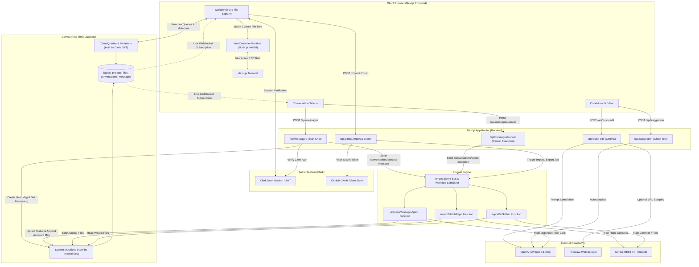
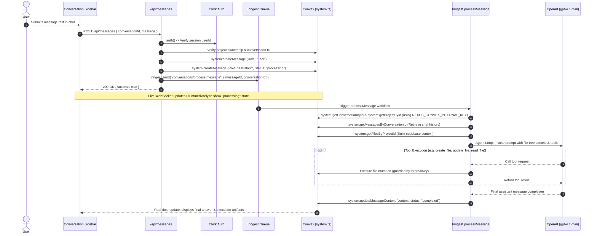
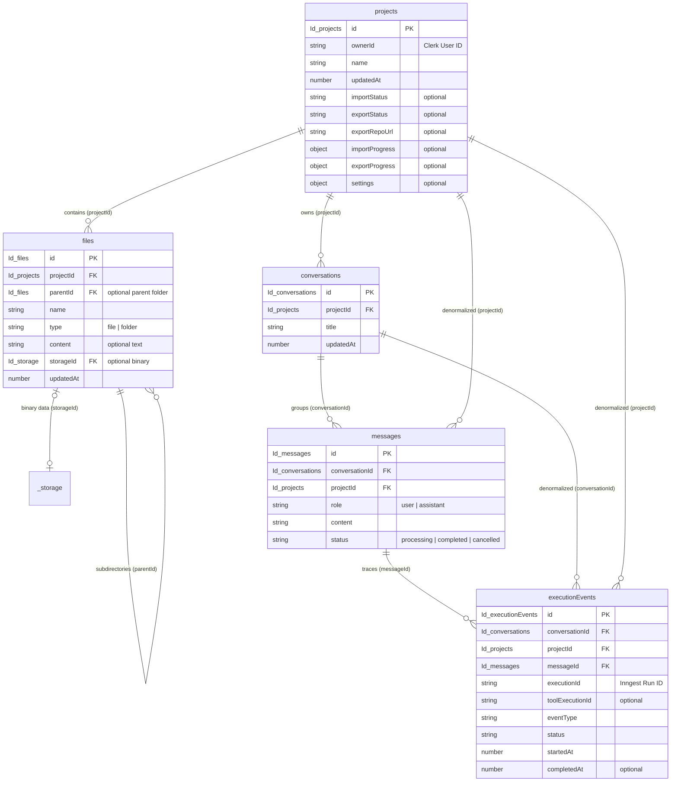
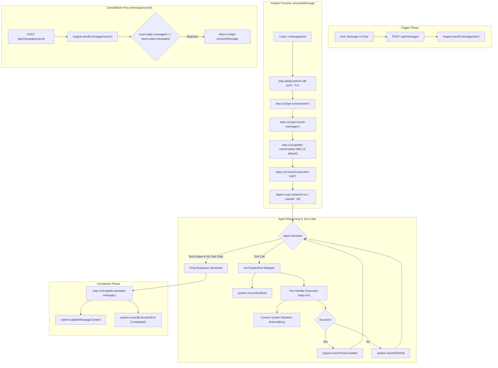

# Nexus Architecture & System Design

This document details the architectural design, component responsibilities, data flow, security boundaries, and background agent execution model in Nexus.

---

## 1. System Overview

Nexus is structured into distinct, decoupled execution layers:

1. **Frontend Presentation & Editing (Next.js 16 / React 19 / CodeMirror 6):**
   - Single-page application rendering the IDE workbench, code editor, file explorer, preview panel, and conversation sidebar.
   - Code editor integrates dynamic syntax highlighting via [`language-extension.ts`](../src/features/editor/extensions/language-extension.ts) and shared setup via [`custom-setup.ts`](../src/features/editor/extensions/custom-setup.ts). For practical instructions on adding or updating language mappings and running their tests, refer to the [Language Extension Contributor Guide](../CONTRIBUTING.md#adding-or-updating-editor-language-support).
   - Subscribes reactively to Convex queries for immediate state synchronization.

2. **Database & Real-Time Sync (Convex):**
   - Cloud-native real-time database maintaining projects, hierarchical files, conversation messages, and execution traces.
   - Enforces user identity using Clerk JWT tokens on client-initiated queries/mutations.
   - Exposes internal system mutations for privileged server-to-server operations guarded by `NEXUS_CONVEX_INTERNAL_KEY`.

3. **Background Job Orchestration (Inngest):**
   - Durable, event-driven workflow engine that executes long-running asynchronous tasks (AI assistant agent iterations, GitHub repository imports, and batched file exports).
   - Handles multi-step orchestration, automatic retries, exponential backoffs, and execution cancellation.

4. **In-Browser Execution Runtime (WebContainer API & xterm.js):**
   - Sandboxed Node.js WebAssembly container running entirely client-side in the browser.
   - Mounts virtual file trees generated from Convex file documents and runs local dev servers, build tools, and interactive terminals.

5. **AI Services (OpenAI & Vercel AI SDK):**
   - Powers ghost-text code autocompletions (`/api/suggestion`), natural language quick edits (`/api/quick-edit`), and multi-step tool-calling assistant agents (`process-message`).

6. **Authentication & Identity (Clerk):**
   - Manages user sessions, JWT issuance for Convex, and user OAuth access tokens for GitHub repository operations.

---

## 2. Architecture Diagram



---

## 3. Component Responsibilities

### Next.js App Router (Client & Server)
- **Frontend Components:** Organizes UI into feature modules (`src/features/`): `auth`, `conversations`, `editor`, `preview`, `projects`.
- **API Routes (`src/app/api/`):** Thin server-side endpoints validating incoming request schemas using Zod, verifying Clerk user sessions via `auth()`, and dispatching durable background jobs to Inngest.

### Convex Real-Time Layer (`convex/`)
- **Schema (`convex/schema.ts`):** Defines strict relational document tables: `projects`, `files`, `conversations`, `messages`.
- **Client Endpoints:** Queries and mutations checking `ctx.auth.getUserIdentity()` to ensure users only access their own projects.
- **System Endpoints (`convex/system.ts`):** Privileged queries/mutations used by Inngest workers and internal APIs, authenticated via `NEXUS_CONVEX_INTERNAL_KEY`.

### Inngest Background Engine (`src/inngest/` & Feature Functions)
- **Durable Step Execution:** Breaks complex workflows into distinct retryable steps (`step.run`).
- **AI Agent Execution:** Hosts the `@inngest/agent-kit` network driving conversation tools and reasoning steps.
- **Rate-Limit & Retry Handling:** Automatically retries transient network or API failures with exponential backoff.

### WebContainer Runtime (`src/features/preview/hooks/use-webcontainer.ts`)
- **Singleton Lifecycle:** Boots a browser-contained Node.js environment (`WebContainer.boot({ coep: "credentialless" })`).
- **Virtual File Tree:** Converts flat Convex files into nested directory structures via `buildFileTree`.
- **Terminal Emulator:** Attaches xterm.js to WebContainer shell processes (`jsh`) for live command execution.

---

## 4. End-to-End AI Message Lifecycle

The processing of an AI assistant message proceeds through the following sequential lifecycle:



---

## 5. Security Architecture & Boundary Isolation

### 1. Client-to-Convex Authentication
- Client interactions with Convex pass Clerk session JWTs automatically through `<ConvexProviderWithClerk>`.
- Public Convex queries and mutations verify identity using `await ctx.auth.getUserIdentity()`. Unauthenticated queries or queries targeting projects owned by another `userId` throw authorization errors.

### 2. Internal Service-to-Convex Authentication (`NEXUS_CONVEX_INTERNAL_KEY`)
- System-level operations (such as AI background workers updating assistant responses or creating files) bypass the end-user request lifecycle.
- To prevent unauthorized manipulation of arbitrary files or projects, all mutations in `convex/system.ts` validate `args.internalKey === process.env.NEXUS_CONVEX_INTERNAL_KEY`.
- If the internal key is absent or mismatched, Convex aborts the mutation immediately.

### 3. Server-Side Secret Isolation
- `CLERK_SECRET_KEY`, `OPENAI_API_KEY`, `FIRECRAWL_API_KEY`, and `NEXUS_CONVEX_INTERNAL_KEY` are strictly server-side variables.
- None of these are prefixed with `NEXT_PUBLIC_`, ensuring they are never bundled into client JavaScript.

### 4. WebContainer Sandbox & Cross-Origin Isolation
- WebContainer requires `SharedArrayBuffer` and WebAssembly threads support in modern browsers.
- In `next.config.ts`, Nexus configures:
  - `Cross-Origin-Embedder-Policy: credentialless`
  - `Cross-Origin-Opener-Policy: same-origin`
- This isolates the browser execution environment, satisfies browser security gates for `SharedArrayBuffer`, and prevents cross-origin data leakage while permitting necessary subresources (fonts, images, external previews) without strict CORP headers.
- For complete browser support matrices, reverse-proxy header preservation guidelines, verification checks, and debugging procedures, see [Section 9: WebContainer Browser Compatibility and Deployment Guide](#9-webcontainer-browser-compatibility-and-deployment-guide).

---

## 6. Development vs. Production Deployment Architecture

For an in-depth breakdown of local development processes, communication topologies, startup sequencing, and local troubleshooting, refer to the [Local Service Topology Guide](local-service-topology.md).

| Dimension | Local Development | Production |
| :--- | :--- | :--- |
| **Next.js Hosting** | `localhost:3000` via `next dev` | Vercel / Node server container |
| **Database** | Convex Dev Deployment (`npx convex dev`) | Convex Production Deployment |
| **Background Jobs** | Local Inngest Dev Server (`npx inngest-cli dev`) | Inngest Cloud / Webhooks |
| **Auth Domain** | `clerk.accounts.dev` | Custom production domain |
| **Internal Key** | Set in `.env.local` + Convex Dev Env | Set in Vercel Env + Convex Prod Env |

---

## 7. API Route Reference

Nexus exposes several Next.js App Router API endpoints under `src/app/api/`. These handle AI code suggestions, conversational assistant tasks, quick code transformations, project lifecycle events, and GitHub integrations.

### A. Overview
- **Location:** All HTTP API route handlers are organized within subdirectories of `src/app/api/` as `route.ts` files exporting standard Next.js App Router methods (`POST`, `GET`, `PUT`).
- **Authentication Model:**
  - **User Endpoints:** Authenticated via Clerk (`await auth()`). Unauthenticated requests receive HTTP `401 Unauthorized` (or HTTP `403 Forbidden` on `/api/suggestion`).
  - **Ownership Verification:** Routes that operate on existing resources (`projectId` or `conversationId`) verify that the entity exists in Convex and that its `ownerId` matches the authenticated `userId`. Failing ownership returns HTTP `403 Forbidden` or `404 Not Found`.
  - **Server-to-Server / Background Endpoints:** Use internal keys (`NEXUS_CONVEX_INTERNAL_KEY`) or Inngest signing keys (`INNGEST_SIGNING_KEY`).
- **Internal Mutations:** Privileged mutations in Convex are executed via internal keys (`api.system.*`) through `@/lib/convex-client`.

---

### B. Route Inventory

| Endpoint | Method(s) | Primary Purpose | Authentication / Security |
|---|---|---|---|
| `/api/messages` | `POST` | Send user message to conversation; cancels active messages and triggers Inngest assistant | Clerk User + Project Ownership |
| `/api/messages/cancel` | `POST` | Cancel active assistant messages and tool execution runs for a project | Clerk User + Project Ownership |
| `/api/quick-edit` | `POST` | Perform in-place AI code edits with optional web scraping via Firecrawl | Clerk User |
| `/api/suggestion` | `POST` | Generate inline ghost-text code completions at cursor position | Clerk User |
| `/api/projects/create-with-prompt` | `POST` | Create a new project and initial conversation seeded from user prompt | Clerk User |
| `/api/github/import` | `POST` | Import a remote GitHub repository into a new Nexus project | Clerk User + Clerk GitHub OAuth |
| `/api/github/export` | `POST` | Export project repository files to GitHub as a new public/private repo | Clerk User + Project Ownership + GitHub OAuth |
| `/api/github/export/cancel` | `POST` | Cancel an in-flight GitHub export workflow and mark status cancelled | Clerk User |
| `/api/github/export/reset` | `POST` | Reset export state and repository URL for a project | Clerk User |
| `/api/inngest` | `GET`, `POST`, `PUT` | Inngest webhook communication and workflow handler execution | Inngest Signature / SDK |

---

### C. Detailed Endpoint Contracts

#### 1. `POST /api/messages`
- **Source:** [`src/app/api/messages/route.ts`](../src/app/api/messages/route.ts)
- **Purpose:** Appends a user prompt to an existing conversation, marks any active assistant messages in the project as cancelled, creates a placeholder assistant message with status `"processing"`, and dispatches an asynchronous Inngest agent execution event.
- **Authentication:** Required (Clerk session).
- **Authorization & Ownership:**
  1. Queries Convex `api.system.getConversationById` to resolve target project ID.
  2. Queries Convex `api.system.getProjectById` and verifies `project.ownerId === userId`.
- **Request Body (JSON):**
  | Field | Type | Required | Description |
  |---|---|---|---|
  | `conversationId` | string | Yes | ID of conversation to receive message |
  | `message` | string | Yes | Non-empty trimmed text prompt |
- **Success Response:** `200 OK`
  ```json
  {
    "success": true,
    "eventId": "01J...",
    "messageId": "msg_..."
  }
  ```
- **Error Responses:**
  - `400 Bad Request`: Invalid request body or empty message.
  - `401 Unauthorized`: Missing or invalid Clerk authentication session.
  - `403 Forbidden`: Authenticated user does not own the target project.
  - `404 Not Found`: Conversation or Project not found.
  - `500 Internal Server Error`: `NEXUS_CONVEX_INTERNAL_KEY` not configured.
- **Background Side Effects:**
  - Dispatches `message/cancel` Inngest events and mutates processing messages to `"cancelled"`.
  - Dispatches `message/sent` event to Inngest to trigger `processMessage` AI loop.

---

#### 2. `POST /api/messages/cancel`
- **Source:** [`src/app/api/messages/cancel/route.ts`](../src/app/api/messages/cancel/route.ts)
- **Purpose:** Cancels any currently processing assistant messages and active background Inngest tool runs for a given project.
- **Authentication:** Required (Clerk session).
- **Authorization & Ownership:**
  - Verifies project exists and `project.ownerId === userId`.
- **Request Body (JSON):**
  | Field | Type | Required | Description |
  |---|---|---|---|
  | `projectId` | string | Yes | Target project ID |
- **Success Response:** `200 OK`
  - When messages were running and cancelled:
    ```json
    { "success": true, "cancelled": true, "messageIds": ["msg_123"] }
    ```
  - When no messages were processing:
    ```json
    { "success": true, "cancelled": false }
    ```
- **Error Responses:**
  - `400 Bad Request`: Missing or invalid `projectId`.
  - `401 Unauthorized`: Unauthenticated request.
  - `403 Forbidden`: User does not own the project.
  - `404 Not Found`: Project not found.
  - `500 Internal Server Error`: Internal key not configured.
- **Background Side Effects:**
  - Sends `message/cancel` to Inngest for each in-flight message.
  - Updates Convex message statuses to `"cancelled"` and records execution termination summary.

---

#### 3. `POST /api/quick-edit`
- **Source:** [`src/app/api/quick-edit/route.ts`](../src/app/api/quick-edit/route.ts)
- **Purpose:** Natural language in-place code modification assistant for selected code regions (Cmd+K / Ctrl+K), with optional external URL scraping via Firecrawl.
- **Authentication:** Required (Clerk session).
- **Authorization & Ownership:** Validates authenticated caller (`userId` check). No project boundary check required as code context is supplied directly in request payload.
- **Request Body (JSON):**
  | Field | Type | Required | Description |
  |---|---|---|---|
  | `selectedCode` | string | Yes | Selected source code block to modify |
  | `instruction` | string | Yes | Natural-language edit instruction |
  | `fullCode` | string | No | Surrounding file content providing context |
- **Success Response:** `200 OK`
  ```json
  { "editedCode": "const x = 42;" }
  ```
- **Error Responses:**
  - `400 Bad Request`: `selectedCode` or `instruction` missing.
  - `401 Unauthorized`: Caller is not logged in.
  - `500 Internal Server Error`: AI generation failure or external provider error.
- **Background Side Effects:**
  - If URLs are detected in instruction, calls Firecrawl scrape API to retrieve Markdown documentation.
  - Calls OpenAI API (`gpt-4.1-mini`) with structured object output schema.

---

#### 4. `POST /api/suggestion`
- **Source:** [`src/app/api/suggestion/route.ts`](../src/app/api/suggestion/route.ts)
- **Purpose:** Generates lightweight real-time inline ghost-text code completions as the user types in the editor.
- **Authentication:** Required (Clerk session). Returns `403 Forbidden` if unauthenticated.
- **Authorization & Ownership:** Caller must be authenticated.
- **Request Body (JSON):**
  | Field | Type | Required | Description |
  |---|---|---|---|
  | `code` | string | Yes | Full file content |
  | `fileName` | string | Yes | Target file name |
  | `currentLine` | string | Yes | Text on active line |
  | `lineNumber` | number | Yes | Active cursor line number |
  | `textBeforeCursor` | string | Yes | Characters preceding cursor on line |
  | `textAfterCursor` | string | Yes | Characters following cursor on line |
  | `previousLines` | string | No | Preceding lines of code context |
  | `nextLines` | string | No | Succeeding lines of code context |
- **Success Response:** `200 OK`
  ```json
  { "suggestion": "return value;" }
  ```
- **Error Responses:**
  - `400 Bad Request`: Missing `code` payload.
  - `403 Forbidden`: Caller is not logged in.
  - `500 Internal Server Error`: Completion generation failure.
- **Background Side Effects:** Invokes OpenAI `gpt-4.1-mini` via Vercel AI SDK.

---

#### 5. `POST /api/projects/create-with-prompt`
- **Source:** [`src/app/api/projects/create-with-prompt/route.ts`](../src/app/api/projects/create-with-prompt/route.ts)
- **Purpose:** Automatically provisions a new project with a unique name, creates its default conversation, inserts the initial user message, and launches the AI assistant Inngest workflow.
- **Authentication:** Required (Clerk session).
- **Authorization & Ownership:** Authenticated user is designated as the `ownerId` of the newly created project in Convex.
- **Request Body (JSON):**
  | Field | Type | Required | Description |
  |---|---|---|---|
  | `prompt` | string | Yes | Initial prompt to bootstrap project |
- **Success Response:** `200 OK`
  ```json
  { "projectId": "proj_123" }
  ```
- **Error Responses:**
  - `400 Bad Request`: Invalid request body or empty prompt.
  - `401 Unauthorized`: Unauthenticated user session.
  - `500 Internal Server Error`: Missing server internal key.
- **Background Side Effects:**
  - Generates 3-word random project identifier (e.g. `fast-blue-tiger`).
  - Calls Convex `api.system.createProjectWithConversation` and `api.system.createMessage`.
  - Dispatches `message/sent` Inngest event to start background agent processing.

---

#### 6. `POST /api/github/import`
- **Source:** [`src/app/api/github/import/route.ts`](../src/app/api/github/import/route.ts)
- **Purpose:** Imports an external GitHub repository into Nexus by creating a local project and dispatching an asynchronous repository cloning & file population job.
- **Authentication:** Required (Clerk user session + Clerk GitHub OAuth token).
- **Authorization & Ownership:** Creates a new project owned by the authenticated `userId`.
- **Request Body (JSON):**
  | Field | Type | Required | Description |
  |---|---|---|---|
  | `url` | string | Yes | Valid GitHub repository URL |
- **Success Response:** `200 OK`
  ```json
  {
    "success": true,
    "projectId": "proj_123",
    "eventId": "01J..."
  }
  ```
- **Error Responses:**
  - `400 Bad Request`: Invalid GitHub URL or GitHub account not linked in Clerk.
  - `401 Unauthorized`: Unauthenticated session.
  - `500 Internal Server Error`: Server configuration error (`NEXUS_CONVEX_INTERNAL_KEY` missing).
- **Background Side Effects:**
  - Retrieves GitHub OAuth token from Clerk OAuth store.
  - Creates project in Convex via `api.system.createProject`.
  - Dispatches `github/import.repo` Inngest job to fetch repository tree and write files.

---

#### 7. `POST /api/github/export`
- **Source:** [`src/app/api/github/export/route.ts`](../src/app/api/github/export/route.ts)
- **Purpose:** Initiates asynchronous batch export of a project's files into a GitHub repository.
- **Authentication:** Required (Clerk user session + Clerk GitHub OAuth token).
- **Authorization & Ownership:** Verifies that the project exists and `project.ownerId === userId`.
- **Request Body (JSON):**
  | Field | Type | Required | Default | Description |
  |---|---|---|---|---|
  | `projectId` | string | Yes | - | ID of project to export |
  | `repoName` | string | Yes | - | Name of target repository (1-100 chars) |
  | `visibility` | string | No | `"private"` | `"public"` or `"private"` |
  | `description` | string | No | - | Optional repository description (max 350 chars) |
- **Success Response:** `200 OK`
  ```json
  {
    "success": true,
    "projectId": "proj_123",
    "eventId": "01J..."
  }
  ```
- **Error Responses:**
  - `400 Bad Request`: Validation failure or GitHub not connected.
  - `401 Unauthorized`: Unauthenticated caller.
  - `403 Forbidden`: User does not own the project.
  - `404 Not Found`: Project does not exist.
  - `500 Internal Server Error`: Server configuration error.
- **Background Side Effects:**
  - Dispatches `github/export.repo` Inngest workflow to batch-upload Git blobs, trees, and commits.

---

#### 8. `POST /api/github/export/cancel`
- **Source:** [`src/app/api/github/export/cancel/route.ts`](../src/app/api/github/export/cancel/route.ts)
- **Purpose:** Cancels an ongoing GitHub export pipeline for a given project.
- **Authentication:** Required (Clerk user session).
- **Authorization & Ownership:** Authenticated session required.
- **Request Body (JSON):**
  | Field | Type | Required | Description |
  |---|---|---|---|
  | `projectId` | string | Yes | Project ID of export to cancel |
- **Success Response:** `200 OK`
  ```json
  { "success": true, "projectId": "proj_123", "eventId": "01J..." }
  ```
- **Error Responses:**
  - `400 Bad Request`: Invalid request payload.
  - `401 Unauthorized`: Unauthenticated caller.
  - `500 Internal Server Error`: Server configuration error.
- **Background Side Effects:**
  - Dispatches `github/export.cancel` to Inngest.
  - Mutates Convex export status to `"cancelled"`.

---

#### 9. `POST /api/github/export/reset`
- **Source:** [`src/app/api/github/export/reset/route.ts`](../src/app/api/github/export/reset/route.ts)
- **Purpose:** Clears export metadata (`exportStatus` and `repoUrl`) on a project, allowing a fresh export attempt.
- **Authentication:** Required (Clerk user session).
- **Authorization & Ownership:** Authenticated session required.
- **Request Body (JSON):**
  | Field | Type | Required | Description |
  |---|---|---|---|
  | `projectId` | string | Yes | Project ID |
- **Success Response:** `200 OK`
  ```json
  { "success": true, "projectId": "proj_123" }
  ```
- **Error Responses:**
  - `400 Bad Request`: Missing project ID.
  - `401 Unauthorized`: Unauthenticated caller.
  - `500 Internal Server Error`: Missing server configuration key.
- **Background Side Effects:** Calls Convex `api.system.updateExportStatus` to reset state to `undefined`.

---

#### 10. `GET`, `POST`, `PUT /api/inngest`
- **Source:** [`src/app/api/inngest/route.ts`](../src/app/api/inngest/route.ts)
- **Purpose:** Serves as the webhook transport endpoint for the Inngest execution engine. Coordinates execution of background workflows:
  - `processMessage`: AI assistant agent multi-step loop.
  - `importGithubRepo`: GitHub repository cloning and file writing.
  - `exportToGithub`: Batched GitHub repository commits and pushes.
- **Authentication & Security:** Managed by Inngest SDK using HMAC header signatures in production or local CLI connection in development.
- **Request & Response:** Handled automatically by `serve()` from `inngest/next`.

---

### D. Security & Ownership Summary

```
+-------------------------------------------------------------------------+
| Authenticated User (Clerk Session)                                      |
+-------------------------------------------------------------------------+
        |
        +---> /api/suggestion                    (Requires Auth)
        +---> /api/quick-edit                     (Requires Auth)
        +---> /api/projects/create-with-prompt   (Requires Auth)
        +---> /api/github/import                 (Requires Auth + GitHub OAuth)
        +---> /api/github/export/cancel          (Requires Auth)
        +---> /api/github/export/reset           (Requires Auth)
        |
        v
+-------------------------------------------------------------------------+
| Ownership Guarded Endpoints (Project ownerId === userId)                |
+-------------------------------------------------------------------------+
        |
        +---> /api/messages                      (Verifies Project Owner)
        +---> /api/messages/cancel               (Verifies Project Owner)
        +---> /api/github/export                 (Verifies Project Owner + OAuth)
        |
        v
+-------------------------------------------------------------------------+
| Internal Execution Boundaries (Guarded by NEXUS_CONVEX_INTERNAL_KEY)    |
+-------------------------------------------------------------------------+
        |
        +---> Convex system.* mutations
        +---> Inngest background workers (/api/inngest)
```

---

### E. Error Handling Conventions

Next.js API routes return consistent JSON error envelopes:
```json
{
  "error": "Descriptive error message"
}
```

HTTP status codes strictly reflect the underlying condition:
- `400 Bad Request`: Malformed JSON, missing mandatory properties, or Zod validation rejections.
- `401 Unauthorized`: Missing Clerk session (unauthenticated user).
- `403 Forbidden`: Authenticated user lacks permission to access or modify the specified project.
- `404 Not Found`: Target project or conversation does not exist.
- `500 Internal Server Error`: Server configuration errors (e.g. missing `NEXUS_CONVEX_INTERNAL_KEY`) or unhandled exceptions.

---

## 8. Convex Data Model and Mutation Lifecycle

Nexus uses [Convex](https://www.convex.dev) as its real-time reactive cloud database and document storage engine. Convex maintains workspace projects, virtual file systems, chat conversations, assistant messages, execution traces, import/export progress states, and environment configurations.

This section details the complete Convex data model, entity relationships, access authorization boundaries, index patterns, cascade deletion lifecycles, and contributor best practices.

### A. Data Model Overview

In Nexus, data persistence and synchronization follow strict boundary principles:
1. **Project as the Primary Ownership Boundary:**
   The `projects` table acts as the primary root entity for user authorization. Every user-created resource—files, conversations, messages, and execution traces—directly or transitively belongs to a project. An entity's access rights are determined by verifying whether the authenticated user's Clerk ID matches the project's `ownerId`.
2. **Document IDs as Typed Foreign References:**
   Convex documents utilize auto-generated, strongly typed IDs (`Id<"tableName">`). Relational integrity across tables (e.g., `files.projectId -> projects._id`, `files.parentId -> files._id`, `messages.conversationId -> conversations._id`) is managed and enforced through application logic in Convex mutations and queries.
3. **Dual Execution Paths (Client vs. System):**
   - **Public client mutations/queries** (`convex/projects.ts`, `convex/conversations.ts`, `convex/files.ts`) verify end-user identity via Clerk JWTs (`await ctx.auth.getUserIdentity()`).
   - **Internal system mutations/queries** (`convex/system.ts`) facilitate background agent workflows (Inngest workers) and Next.js server actions, secured by `args.internalKey === process.env.NEXUS_CONVEX_INTERNAL_KEY`.
4. **Source of Truth:**
   The definitive schema definitions reside in [`convex/schema.ts`](../convex/schema.ts), while the concrete authorization and lifecycle semantics are enforced across [`convex/projects.ts`](../convex/projects.ts), [`convex/conversations.ts`](../convex/conversations.ts), [`convex/files.ts`](../convex/files.ts), and [`convex/system.ts`](../convex/system.ts).

---

### B. Table Reference

The Convex database schema defines 5 document tables: `projects`, `files`, `conversations`, `messages`, and `executionEvents`.

#### 1. `projects`
- **Source:** [`convex/schema.ts`](../convex/schema.ts#L5-L71)
- **Purpose:** Root entity representing a user's development workspace, containing project metadata, Git import/export statuses, batched progress tracking, and runtime execution settings.
- **Important Fields:**
  - `name` (`v.string()`): Display name of the project.
  - `ownerId` (`v.string()`): Clerk user ID (`identity.subject`) establishing project ownership.
  - `updatedAt` (`v.number()`): Timestamp of the most recent project modification.
  - `importStatus` (*optional* `v.union("importing", "completed", "failed")`): Current status of GitHub repository import.
  - `exportStatus` (*optional* `v.union("exporting", "completed", "failed", "cancelled")`): Current status of GitHub repository export.
  - `exportRepoUrl` (*optional* `v.string()`): Target repository URL for exported project.
  - `importProgress` (*optional* `v.object(...)`): Detailed batch counters for repository import (`totalFiles`, `processedFiles`, `successfulFiles`, `failedFiles`, `skippedFiles`, `currentBatch`, `totalBatches`, `errorMessage`, `updatedAt`).
  - `exportProgress` (*optional* `v.object(...)`): Detailed batch counters for repository export (`status`, `totalFiles`, `processedFiles`, `successfulFiles`, `failedFiles`, `skippedFiles`, `currentBatch`, `totalBatches`, `errorMessage`, `updatedAt`).
  - `settings` (*optional* `v.object(...)`): Runtime preview settings (`installCommand`, `devCommand`, `envVariables: Record<string, string>`).
- **Parent Relationship:** None (root workspace entity).
- **Ownership:** Explicitly owned by the user matching `ownerId`.
- **Indexes:**
  - `by_owner` on `["ownerId"]`: Fast retrieval of all projects owned by a specific user.
- **Lifecycle:** Created via client mutation `create` in `projects.ts` or system mutation `createProject` / `createProjectWithConversation` in `system.ts`. Updated on settings changes, rename, import/export steps, or file touches. Deleted via `deleteProject` in `projects.ts`.

#### 2. `files`
- **Source:** [`convex/schema.ts`](../convex/schema.ts#L73-L85)
- **Purpose:** Represents a file or directory node in the workspace virtual file system hierarchy. Supports both text files and binary storage-backed files.
- **Important Fields:**
  - `projectId` (`v.id("projects")`): Reference to the parent project workspace.
  - `parentId` (*optional* `v.id("files")`): Reference to parent directory folder node; `undefined` indicates a root-level workspace file or folder.
  - `name` (`v.string()`): Filename or directory name (must be unique among siblings sharing the same `parentId`).
  - `type` (`v.union("file", "folder")`): Discriminator indicating whether the node is a directory or a file.
  - `content` (*optional* `v.string()`): UTF-8 text content (populated for text files only; absent for binary files and folders).
  - `storageId` (*optional* `v.id("_storage")`): Reference to Convex binary storage file (populated for binary files only; absent for text files and folders).
  - `updatedAt` (`v.number()`): Timestamp of last file creation, content update, or rename.
- **Parent Relationship:** References `projects._id` via `projectId`, and optionally references `files._id` via `parentId`.
- **Ownership:** Inherited through `projectId -> projects.ownerId`.
- **Indexes:**
  - `by_project` on `["projectId"]`: Retrieves all files belonging to a project.
  - `by_parent` on `["parentId"]`: Locates immediate child items of a folder.
  - `by_project_parent` on `["projectId", "parentId"]`: Fast retrieval of siblings in a directory within a specific project.
- **Lifecycle:** Created via client mutations `createFile`/`createFolder` in `files.ts` or system mutations `createFile`/`createFiles`/`createBinaryFile`/`createFolder` in `system.ts`. Updated via `updateFile` and `renameFile`. Deleted recursively via `deleteFile` in `files.ts` or `deleteFile`/`cleanup` in `system.ts` (also deleting any associated `storageId` object from Convex storage).

#### 3. `conversations`
- **Source:** [`convex/schema.ts`](../convex/schema.ts#L86-L91)
- **Purpose:** Represents an AI assistant chat thread associated with a project.
- **Important Fields:**
  - `projectId` (`v.id("projects")`): Reference to the project owning the conversation.
  - `title` (`v.string()`): User-facing title of the chat conversation.
  - `updatedAt` (`v.number()`): Timestamp updated whenever new messages are appended or titles renamed.
- **Parent Relationship:** References `projects._id` via `projectId`.
- **Ownership:** Inherited through `projectId -> projects.ownerId`.
- **Indexes:**
  - `by_project` on `["projectId"]`: Queries conversations for a project ordered by recency.
- **Lifecycle:** Created via client mutation `create` in `conversations.ts` or system mutation `createProjectWithConversation` in `system.ts`. Title updated via `updateConversationTitle` in `system.ts`. Deleted during project cascade deletion (`deleteProject` in `projects.ts`).

#### 4. `messages`
- **Source:** [`convex/schema.ts`](../convex/schema.ts#L92-L107)
- **Purpose:** Stores individual conversational turns between the user and the AI assistant within a conversation.
- **Important Fields:**
  - `conversationId` (`v.id("conversations")`): Parent conversation reference.
  - `projectId` (`v.id("projects")`): Denormalized project reference for project-scoped queries and cancellation checks.
  - `role` (`v.union("user", "assistant")`): Author role of the message.
  - `content` (`v.string()`): Markdown or plain text content of the message.
  - `status` (*optional* `v.union("processing", "completed", "cancelled")`): Lifecycle state of assistant generation.
- **Parent Relationship:** References `conversations._id` via `conversationId`, and references `projects._id` via `projectId`.
- **Ownership:** Inherited through `projectId -> projects.ownerId` (verified via `conversations.projectId` lookup).
- **Indexes:**
  - `by_conversation` on `["conversationId"]`: Retrieves conversation messages in chronological order.
  - `by_project_status` on `["projectId", "status"]`: Finds active messages (e.g. `processing`) within a project for cancellation or replacement.
- **Lifecycle:** Created by system mutation `createMessage` in `system.ts`. Updated incrementally via `updateMessageStreamContent`, `updateMessageContent`, or `updateMessageStatus`. Deleted during project deletion (`deleteProject` in `projects.ts`).

#### 5. `executionEvents`
- **Source:** [`convex/schema.ts`](../convex/schema.ts#L108-L142)
- **Purpose:** Records fine-grained tool invocation steps, execution milestones, and assistant reasoning progress for an assistant message run.
- **Important Fields:**
  - `conversationId` (`v.id("conversations")`): Associated conversation thread.
  - `projectId` (`v.id("projects")`): Associated project workspace.
  - `messageId` (`v.id("messages")`): Associated assistant message.
  - `executionId` (`v.string()`): Unique Inngest run identifier for the execution job.
  - `iteration` (`v.number()`): Agent step iteration counter.
  - `eventType` (`v.union("tool_start", "tool_complete", "tool_fail", "execution_start", "execution_complete", "execution_cancel", "execution_fail")`): Specific event milestone.
  - `toolExecutionId` (*optional* `v.string()`): Deterministic tool execution identifier ensuring retry idempotency.
  - `toolName` (*optional* `v.string()`): Name of invoked tool (e.g., `createFiles`, `updateFile`, `readFiles`, `listFiles`).
  - `description` (*optional* `v.string()`): Human-readable summary of the action.
  - `filePaths` (*optional* `v.array(v.string())`): Workspace-relative paths touched by the tool.
  - `status` (`v.union("running", "completed", "failed", "cancelled")`): Current execution status of the event.
  - `startedAt` (`v.number()`): Timestamp when the tool or execution started.
  - `completedAt` (*optional* `v.number()`): Timestamp when the tool or execution completed.
  - `summary` (*optional* `v.string()`): Output summary or result details.
  - `error` (*optional* `v.string()`): Error message if the tool or execution failed.
- **Parent Relationship:** References `messages._id` via `messageId`, `conversations._id` via `conversationId`, and `projects._id` via `projectId`.
- **Ownership:** Inherited through `projectId -> projects.ownerId` (verified in queries through `conversations.projectId`).
- **Indexes:**
  - `by_message` on `["messageId"]`: Fetches all execution events for a specific assistant message.
  - `by_conversation` on `["conversationId"]`: Retrieves chronological event stream for a conversation.
  - `by_execution` on `["executionId"]`: Tracks and updates running events for an Inngest execution run.
  - `by_tool_execution` on `["toolExecutionId"]`: Idempotency lookup for step retries.
- **Lifecycle:** Recorded by system mutations `recordExecutionStart`, `recordToolStart`, `recordToolComplete`, `recordToolFail`, and `recordExecutionEnd` in `system.ts`. Queried by client query `getExecutionEvents` in `conversations.ts` or `getExecutionEventsByMessage` in `system.ts`.

---

### C. Entity Relationship Diagram

The following diagram illustrates the relationships between Convex entities. Foreign key constraints are enforced at the application mutation level rather than by the database engine:



---

### D. Ownership and Authorization Boundaries

Convex functions enforce strict authorization boundaries depending on whether they are client-facing or system-internal:

```
+------------------------------------------------------------------------------------+
| Client-Facing Functions (convex/projects.ts, convex/conversations.ts, files.ts)    |
+------------------------------------------------------------------------------------+
  1. Verify Authentication:
     const identity = await verifyAuth(ctx); // ctx.auth.getUserIdentity()
  2. Resolve Project Context:
     const project = await ctx.db.get("projects", projectId);
  3. Verify Project Ownership:
     if (project.ownerId !== identity.subject) throw new Error("Unauthorized");

+------------------------------------------------------------------------------------+
| Internal System Functions (convex/system.ts)                                       |
+------------------------------------------------------------------------------------+
  1. Verify Internal Secret:
     validateInternalKey(args.internalKey); // args.internalKey === process.env.NEXUS_CONVEX_INTERNAL_KEY
  2. Server-to-Server Trust:
     Assumes caller (Inngest worker or Next.js route) has already verified user identity.
```

- **Public Client Queries & Mutations:**
  - Require a valid Clerk JWT.
  - Functions in `convex/files.ts` and `convex/conversations.ts` lookup the target document, resolve its associated `projectId`, fetch the project document, and verify that `project.ownerId === identity.subject`.
  - Any attempt by User B to query or modify User A's files, conversations, or projects fails with an unauthorized error.
- **Internal System Queries & Mutations:**
  - Do not call `ctx.auth.getUserIdentity()`. They are called from trusted backend processes (Inngest functions or Next.js API routes) using `@/lib/convex-client`.
  - Protected exclusively by `validateInternalKey(args.internalKey)`.
  - Never expose internal system endpoints directly to frontend clients.

---

### E. Important Indexes and Access Patterns

The schema defines targeted indexes to ensure efficient real-time queries and updates:

| Table | Index Name | Indexed Fields | Supported Access Pattern |
|---|---|---|---|
| `projects` | `by_owner` | `["ownerId"]` | Listing all projects owned by the authenticated user (`projects.get`, `projects.getPartial`). |
| `files` | `by_project` | `["projectId"]` | Full file tree retrieval (`files.getFiles`, WebContainer mounting, project export, project deletion cleanup). |
| `files` | `by_parent` | `["parentId"]` | Traversal of child items in folder structures. |
| `files` | `by_project_parent` | `["projectId", "parentId"]` | Immediate folder directory listing (`files.getFolderContents`), sibling collision checks for create/rename. |
| `conversations` | `by_project` | `["projectId"]` | Listing conversation threads within a project ordered by recency (`conversations.getByProject`). |
| `messages` | `by_conversation` | `["conversationId"]` | Chronological chat history retrieval (`conversations.getMessages`, `system.getRecentMessages`). |
| `messages` | `by_project_status` | `["projectId", "status"]` | Project-scoped active assistant message cancellation and replacement (`system.getProcessingMessages`). |
| `executionEvents` | `by_message` | `["messageId"]` | Fetching tool and execution trace events for an individual assistant message card. |
| `executionEvents` | `by_conversation` | `["conversationId"]` | Conversation-wide real-time execution stream (`conversations.getExecutionEvents`). |
| `executionEvents` | `by_execution` | `["executionId"]` | Inngest execution lifecycle updates (`system.recordExecutionEnd`). |
| `executionEvents` | `by_tool_execution`| `["toolExecutionId"]` | Idempotent step retry checks for tool execution events (`system.recordToolStart`). |

---

### F. Cascade Deletion and Cleanup Responsibilities

Convex does not provide database-level cascading foreign keys. All cascade deletions and storage cleanups are handled explicitly by mutation code.

#### Cascade Deletion Matrix

| Parent Deletion | Related Records | Cleanup Mechanism | Source Implementation |
|---|---|---|---|
| **Project** (`deleteProject`) | `messages` | Queried by `projectId` and by each conversation's `by_conversation` index; deleted before conversation records. | [`convex/projects.ts`](../convex/projects.ts#L130-L159) |
| **Project** (`deleteProject`) | `conversations` | Queried via `by_project` index; deleted after child messages are deleted. | [`convex/projects.ts`](../convex/projects.ts#L141-L159) |
| **Project** (`deleteProject`) | `files` | Queried via `by_project` index; deleted document by document. | [`convex/projects.ts`](../convex/projects.ts#L161-L192) |
| **Project** (`deleteProject`) | Binary Storage (`_storage`) | Deleted via `ctx.storage.delete(file.storageId)` for any binary files before file record deletion. Throws on genuine failure to prevent orphaned storage. | [`convex/projects.ts`](../convex/projects.ts#L168-L190) |
| **Project** (`deleteProject`) | `executionEvents` | **Not explicitly deleted.** Execution events retain historical trace logs unless manually purged. | [`convex/projects.ts`](../convex/projects.ts#L116-L199) |
| **Folder File** (`deleteFile`) | Nested `files` & folders | Recursive deletion (`deleteRecursive`) queries children via `by_project_parent`, deletes descendants depth-first. | [`convex/files.ts`](../convex/files.ts#L270-L289) |
| **Binary File** (`deleteFile`) | Binary Storage (`_storage`) | Deleted via `ctx.storage.delete(item.storageId)` prior to file document deletion. | [`convex/files.ts`](../convex/files.ts#L286) |
| **Project Files** (`cleanup`) | Project `files` & storage | Bulk deletes all project files and associated storage files (used prior to repository re-import). | [`convex/system.ts`](../convex/system.ts#L478-L500) |

> [!IMPORTANT]
> When deleting projects, deletion operations are sequentially executed within a single Convex mutation transaction. Storage files are deleted prior to document records. If a storage deletion fails unexpectedly (excluding benign 404/not found errors), the mutation throws to avoid leaving untracked orphan storage objects.

---

### G. Mutation Lifecycle Checklist for Contributors

When implementing new Convex mutations or queries, follow this verification checklist:

1. **Determine Function Scope:**
   - Use public client functions (`mutation`, `query`) for UI operations initiated with Clerk authentication.
   - Use internal functions in `convex/system.ts` with `internalKey` validation for Inngest background workers and Next.js server actions.
2. **Enforce Identity and Ownership:**
   - In public endpoints, always call `const identity = await verifyAuth(ctx);`.
   - Never trust caller-supplied `ownerId` or `userId`. Always check against `identity.subject`.
   - For child entities (files, conversations, messages), retrieve the parent project and verify `project.ownerId === identity.subject`.
3. **Input Validation:**
   - Define strict argument validators using Convex `v.*` primitives (e.g. `v.id(...)`, `v.string()`, `v.union(...)`).
4. **Query Performance & Index Usage:**
   - Never perform unbounded table scans. Always use `.withIndex(...)` with the appropriate index (`by_project`, `by_project_parent`, `by_conversation`, etc.).
5. **Idempotency & Concurrency:**
   - Background steps invoked by Inngest must be idempotent. Use unique execution or tool keys (`by_tool_execution`, `by_execution`) to prevent duplicate writes on step retry.
6. **Terminal State Protection:**
   - Do not overwrite terminal states (e.g., messages or execution events marked `cancelled`) with stale background updates.
7. **Cascade Cleanup:**
   - If deleting parent entities, clean up associated children and delete storage files (`ctx.storage.delete(storageId)`).
8. **Denormalization Consistency:**
   - When mutating child entities that update parent summary fields (e.g. `projects.updatedAt`), patch the parent entity within the same mutation.
9. **Security & Secrets:**
   - Never store sensitive secrets, tokens, or credentials in project documents or execution event logs.
10. **Automated Testing:**
    - Write unit and regression tests verifying both authorized paths and unauthorized rejections (e.g. User B accessing User A's resources).

---

## 9. WebContainer Browser Compatibility and Deployment Guide

Nexus executes client-side Node.js containers directly inside the browser using the [WebContainer API](https://webcontainers.io) (`@webcontainer/api`) and [xterm.js](https://xtermjs.org). This powers the in-browser development environment, interactive terminal shell (`jsh`), dependency installation (`npm install`), and live project preview server.

Because WebContainer emulates an entire operating system process tree using WebAssembly and multi-threaded worker pools, it relies on modern browser primitives that are gated behind strict web security constraints.

---

### A. Required Browser Capabilities & Security Primitives

WebContainer runtime execution depends on three core browser security capabilities:

1. **`SharedArrayBuffer`:**
   - Used for low-latency shared-memory IPC between the main browser thread and WebContainer WebAssembly worker threads.
   - Following Spectre/Meltdown vulnerability mitigations, all major browser engines strictly gate `SharedArrayBuffer` access. It is **only** defined when `window.crossOriginIsolated === true`.
2. **WebAssembly Multi-Threading & SIMD:**
   - The WebContainer Node.js kernel is compiled to WebAssembly with thread support (`Atomics` and memory sharing).
   - Supported in all modern Chromium, Firefox, and Safari engines that support `SharedArrayBuffer`.
3. **Secure Context (`window.isSecureContext`):**
   - Cross-origin isolation and WebContainers can **only** be established in a Secure Context:
     - `https://` origins in production, staging, or previews.
     - `http://localhost` or `http://127.0.0.1` origins in local development.
   - Accessing Nexus via raw IP addresses over plain HTTP (e.g., `http://192.168.1.50:3000`) is **not** a secure context, meaning `crossOriginIsolated` will be `false` and WebContainer will fail to boot.

---

### B. Browser Compatibility Matrix

| Browser Engine / Platform | Minimum Version | Support Level | Technical Notes |
| :--- | :--- | :--- | :--- |
| **Google Chrome / Chromium** | 96+ | **Full Support** (Recommended) | Fully supports COEP `credentialless` and `same-origin` COOP with optimal WebAssembly execution speed. |
| **Microsoft Edge** | 96+ | **Full Support** | Chromium-based; identical compatibility and performance to Google Chrome. |
| **Brave / Opera / Vivaldi** | Chromium 96+ | **Full Support** | In Brave, default shields do not block WebContainers on secure origins, provided headers are served. |
| **Mozilla Firefox** | 103+ | **Full Support** | Firefox 103+ introduced full support for COEP `credentialless`. Firefox requires strict origin isolation and Secure Context. |
| **Safari (macOS)** | 16.4+ | **Supported** | Safari 16.4+ added support for `SharedArrayBuffer` in cross-origin isolated contexts. |
| **Safari (iOS / iPadOS)** | iOS 16.4+ | **Limited** | Requires iOS 16.4+. Memory limits on mobile devices may limit large `npm install` runs; desktop browsers are strongly recommended. |
| **Android Chrome** | 96+ | **Supported** | Functional, though device memory constraints can impact container compilation and heavy dev servers. |

---

### C. HTTP Response Headers & Cross-Origin Isolation Architecture

To enable `window.crossOriginIsolated` without breaking third-party assets, Nexus configures the following HTTP response headers in [`next.config.ts`](../next.config.ts):

```typescript
async headers() {
  return [
    {
      source: "/:path*",
      headers: [
        {
          key: "Cross-Origin-Embedder-Policy",
          value: "credentialless",
        },
        {
          key: "Cross-Origin-Opener-Policy",
          value: "same-origin",
        },
      ],
    },
  ];
}
```

#### Why `credentialless` instead of `require-corp`?
- **Traditional COEP (`require-corp`):** Mandates that *every* cross-origin subresource (Google Fonts, third-party user avatars, CDN stylesheets, Clerk auth scripts, external embeds) explicitly respond with a `Cross-Origin-Resource-Policy: cross-origin` header. If an external service omits CORP, the browser blocks the subresource.
- **Modern COEP (`credentialless`):** Allows cross-origin subresources to load without CORP headers by stripping user credentials (cookies, client certificates, HTTP authorization headers) from those requests. This achieves cross-origin isolation while preserving seamless integration with third-party auth, analytics, icons, and fonts.
- **Runtime Hook Configuration:** The singleton WebContainer boot in `src/features/preview/hooks/use-webcontainer.ts` explicitly matches this policy:
  ```typescript
  WebContainer.boot({ coep: "credentialless" });
  ```

---

### D. Production Deployment, CDNs, and Reverse Proxies

When deploying Nexus beyond local development, hosting infrastructure and proxy layers must preserve or inject COOP/COEP headers.

#### 1. Vercel Deployment
- Next.js `headers()` configured in `next.config.ts` are automatically applied to all serverless lambdas and edge routing on Vercel.
- Ensure no edge middleware strips response headers.

#### 2. Nginx Reverse Proxy
If deploying Next.js in a standalone Node container behind Nginx, verify that Nginx does not suppress application headers, or explicitly inject them in your `server` or `location` block:

```nginx
location / {
    proxy_pass http://127.0.0.1:3000;
    proxy_http_version 1.1;
    proxy_set_header Upgrade $http_upgrade;
    proxy_set_header Connection "upgrade";
    proxy_set_header Host $host;
    proxy_set_header X-Forwarded-Proto $scheme;

    # Ensure cross-origin isolation headers are delivered to clients
    add_header Cross-Origin-Embedder-Policy "credentialless" always;
    add_header Cross-Origin-Opener-Policy "same-origin" always;
}
```

#### 3. Cloudflare (CDN / Proxy)
- **SSL/TLS Mode:** Must be set to **Full** or **Full (Strict)**. WebContainer will fail if accessed over plain HTTP.
- **Transform Rules / Response Headers:** If using Cloudflare Transform Rules to modify headers, ensure `Cross-Origin-Embedder-Policy` and `Cross-Origin-Opener-Policy` are never overridden or stripped.
- **Cloudflare Rocket Loader:** May interfere with WebAssembly and worker thread initialization; test preview pages with Rocket Loader disabled if unexpected boot hangs occur.

#### 4. Docker Container / Self-Hosted Node.js Server
- When building with `output: "standalone"` or running `next start`, Next.js serves the configured headers natively.
- When hosting behind Kubernetes Ingress (e.g. `ingress-nginx` or Traefik), ensure SSL termination is properly configured so the client receives requests over `https://`.

---

### E. Verification Procedures for Contributors

Contributors can quickly verify that their local or deployment environment satisfies all WebContainer prerequisites:

#### 1. Browser Console Verification
Open your browser's Developer Tools (F12) Console on the Nexus project view (`/projects/[projectId]`) and run:

```javascript
console.table({
  "Secure Context (HTTPS or localhost)": window.isSecureContext,
  "Cross-Origin Isolated": window.crossOriginIsolated,
  "SharedArrayBuffer Available": typeof window.SharedArrayBuffer !== "undefined",
  "WebAssembly Supported": typeof window.WebAssembly !== "undefined",
});
```

All four values **must evaluate to `true`**. If `Cross-Origin Isolated` or `SharedArrayBuffer Available` is `false`, WebContainer cannot start.

#### 2. Network Header Inspection (`curl`)
Verify response headers from the command line:

```bash
# Local development check
curl -I http://localhost:3000/projects/sample-id

# Production deployment check
curl -I https://your-nexus-domain.com
```

**Expected Output Headers:**
```http
Cross-Origin-Embedder-Policy: credentialless
Cross-Origin-Opener-Policy: same-origin
```

---

### F. Troubleshooting & Diagnostic Guide

| Symptom / Error | Root Cause | Diagnostic Steps & Remediation |
| :--- | :--- | :--- |
| **`SharedArrayBuffer is not defined`** | Missing cross-origin isolation (`crossOriginIsolated === false`). | 1. Check `window.isSecureContext` in console.<br/>2. If on local network, use `http://localhost:3000` instead of `http://192.168.x.x:3000`.<br/>3. Verify COOP and COEP headers using `curl -I`.<br/>4. Ensure reverse proxy or CDN is not stripping headers. |
| **Terminal blank or stuck at "Booting..."** | Previous WebContainer session not cleanly torn down, or browser lacks WebAssembly worker permissions. | 1. Click the **Restart Container** button in the preview header.<br/>2. Inspect console for WebContainer error logs.<br/>3. Clear browser cache and perform a hard refresh (`Ctrl+F5` / `Cmd+Shift+R`). |
| **`WebContainer requires COEP: credentialless`** | Mismatch between `next.config.ts` headers and `WebContainer.boot({ coep })`. | Verify that `next.config.ts` serves `Cross-Origin-Embedder-Policy: credentialless` and `src/features/preview/hooks/use-webcontainer.ts` boots with `{ coep: "credentialless" }`. |
| **External preview iframe refused to connect / X-Frame-Options** | Preview application attempting to load non-embeddable external URLs. | WebContainer runs a local in-browser virtual dev server. The internal preview iframe points to the WebContainer port URL. External sites embedding Nexus or being embedded inside preview must allow iframe embedding. |
| **`Out of memory` during `npm install`** | Browser tab memory limit exceeded during heavy package dependency resolution. | 1. WebContainer runs in browser WebAssembly memory (typically capped at 2GB–4GB by browser engines).<br/>2. Avoid adding monolithic packages or native C++ add-ons requiring node-gyp compilation (WebContainer only supports pure JS/WASM packages).<br/>3. Restart container to release memory. |
| **Clerk authentication popups blocked / closing unexpectedly** | Interaction between COOP `same-origin` and third-party OAuth popup windows. | COOP `same-origin` prevents the opener window from interacting with cross-origin popups. Clerk's modal and redirect flows are designed to work within isolated contexts. If OAuth popups detach, ensure authentication redirects flow cleanly through Clerk callback endpoints. |

---

### G. Code Audit Finding & Observation

During our architectural audit of Nexus WebContainer integration:
- In [`next.config.ts`](../next.config.ts), `headers()` applies COOP/COEP to all routes (`/:path*`).
- In [`src/features/preview/hooks/use-webcontainer.ts`](../src/features/preview/hooks/use-webcontainer.ts), `WebContainer.boot({ coep: "credentialless" })` correctly coordinates with the credentialless policy.
- In production environments where developers test on mobile devices or local network IP addresses (`http://192.168.x.x:3000`), browsers will report `window.isSecureContext === false` and disable `SharedArrayBuffer`. When testing on non-localhost physical devices, an HTTPS proxy (such as `mkcert` or `ngrok http 3000`) is required to establish a valid Secure Context.

---

## 10. Inngest Agent Tools and Execution Conventions

Nexus employs an autonomous AI coding assistant powered by [Inngest Agent Kit](https://github.com/inngest/agent-kit) running within background Inngest serverless workflow functions. This section provides an architectural and operational reference for agent tools, execution tracking, data-layer mutations, authorization boundaries, retry semantics, and cancellation behaviors.

### A. Overview

The AI message processing architecture connects users with an autonomous reasoning loop capable of reading, creating, modifying, and organizing project codebases:



Key architectural characteristics:
- **Decoupled Asynchronous Processing:** Initiated via `POST /api/messages`, returning HTTP 200 immediately while Inngest manages the durable agent loop.
- **Agent Network Architecture:** Configured via `createNetwork` with a single primary coding agent (`name: "nexus"`, model: `gpt-4.1-mini`), a maximum iteration bound (`maxIter: 10`), and an explicit router that loops until the agent generates a text response without accompanying tool calls.
- **Internal System Boundary:** Tools interact with Convex exclusively via privileged system queries and mutations in `convex/system.ts` validated with `NEXUS_CONVEX_INTERNAL_KEY`.
- **Live Lifecycle Tracing:** Every tool call and agent iteration dispatches structured events to the `executionEvents` table, enabling real-time streaming progress in the client UI.

---

### B. Agent Tool Registration

All agent tools are instantiated and registered inside [`src/features/conversations/inngest/process-message.ts`](../src/features/conversations/inngest/process-message.ts#L210-L219).

Tools are created using factory functions located in [`src/features/conversations/inngest/tools/`](../src/features/conversations/inngest/tools/). Factory parameters pass required execution context (such as `projectId`, `internalKey`, and the deterministic `context: ToolExecutionContext`) into the tool instance:

```typescript
// Tool registration in process-message.ts
tools: [
  createListFilesTool({ internalKey, projectId, context: toolContext }),
  createReadFilesTool({ internalKey, context: toolContext }),
  createUpdateFileTool({ internalKey, context: toolContext }),
  createCreateFilesTool({ projectId, internalKey, context: toolContext }),
  createCreateFolderTool({ projectId, internalKey }),
  createRenameFileTool({ internalKey }),
  createDeleteFilesTool({ internalKey }),
  createScrapeUrlsTool(),
]
```

#### Inventory of Registered Tools vs. Internal Helpers

| Tool Name | Implementation File | Registered? | Primary Purpose |
|---|---|:---:|---|
| `listFiles` | [`tools/list-files.ts`](../src/features/conversations/inngest/tools/list-files.ts) | Yes | Query project hierarchy (names, IDs, types, and parent folder IDs) |
| `readFiles` | [`tools/read-files.ts`](../src/features/conversations/inngest/tools/read-files.ts) | Yes | Read text content of files by their Convex file IDs |
| `updateFile` | [`tools/update-file.ts`](../src/features/conversations/inngest/tools/update-file.ts) | Yes | Overwrite text content of an existing file |
| `createFiles` | [`tools/create-files.ts`](../src/features/conversations/inngest/tools/create-files.ts) | Yes | Batch create one or more files under a shared parent folder |
| `createFolder` | [`tools/create-folder.ts`](../src/features/conversations/inngest/tools/create-folder.ts) | Yes | Create a new directory folder under a parent folder or at root |
| `renameFile` | [`tools/rename-file.ts`](../src/features/conversations/inngest/tools/rename-file.ts) | Yes | Rename an existing file or folder document |
| `deleteFiles` | [`tools/delete-files.ts`](../src/features/conversations/inngest/tools/delete-files.ts) | Yes | Delete one or more files or folders (recursive child deletion) |
| `scrapeUrls` | [`tools/scrape-urls.ts`](../src/features/conversations/inngest/tools/scrape-urls.ts) | Yes | Fetch markdown content from external URLs via Firecrawl |
| `runTrackedTool` | [`tools/tracker.ts`](../src/features/conversations/inngest/tools/tracker.ts) | No *(Helper)* | Execution lifecycle wrapper recording Convex `executionEvents` |
| `ToolExecutionContext` | [`tools/types.ts`](../src/features/conversations/inngest/tools/types.ts) | No *(Type)* | TypeScript context contract passed from `process-message.ts` |

---

### C. Registered Tool Catalog

#### 1. `listFiles`
- **Source:** [`src/features/conversations/inngest/tools/list-files.ts`](../src/features/conversations/inngest/tools/list-files.ts)
- **Description:** Lists all file and folder documents belonging to the project. Used by the agent to discover the project structure, locate file IDs, and find folder IDs before creating or modifying items.
- **Parameters Schema:** `z.object({})` (Takes no input parameters).
- **Output:** JSON string representing an array of items sorted with folders first, then files alphabetically:
  ```json
  [
    { "id": "k17...", "name": "src", "type": "folder", "parentId": null },
    { "id": "k18...", "name": "index.ts", "type": "file", "parentId": "k17..." }
  ]
  ```
- **Convex Operations:**
  - Query: `api.system.getProjectFiles` (reads all files indexed by `by_project`).
- **Tracking:** Wrapped in `runTrackedTool`. Records tool start and summary with item count.

#### 2. `readFiles`
- **Source:** [`src/features/conversations/inngest/tools/read-files.ts`](../src/features/conversations/inngest/tools/read-files.ts)
- **Description:** Reads file contents for specified file IDs.
- **Parameters Schema:**
  | Field | Type | Required | Description |
  |---|---|---|---|
  | `fileIds` | `string[]` | Yes | Array of Convex file IDs (`min(1)`). |
- **Output:** JSON string array of objects `{ id, name, content }`.
- **Convex Operations:**
  - Query: `api.system.getFileById` for each requested file ID.
- **Behavior & Errors:**
  - Validates input format; if none of the provided IDs resolve to files with content, throws `"No files found with provided IDs. Use listFiles to get valid fileIDs."`.
- **Tracking:** Wrapped in `runTrackedTool`. Tracks resolved file names in `filePaths`.

#### 3. `updateFile`
- **Source:** [`src/features/conversations/inngest/tools/update-file.ts`](../src/features/conversations/inngest/tools/update-file.ts)
- **Description:** Updates the text content of a single existing file.
- **Parameters Schema:**
  | Field | Type | Required | Description |
  |---|---|---|---|
  | `fileId` | `string` | Yes | The ID of the file to update (`min(1)`). |
  | `content` | `string` | Yes | The complete new text content for the file. |
- **Output:** Confirmation string: `"File \"<name>\" updated successfully"`.
- **Convex Operations:**
  - Query: `api.system.getFileById` (validates file existence and checks `file.type !== "folder"`).
  - Mutation: `api.system.updateFile` (patches `content` and updates `updatedAt`).
- **Behavior & Errors:**
  - Returns explicit error string if ID does not exist or targets a folder.
- **Tracking:** Wrapped in `runTrackedTool`.

#### 4. `createFiles`
- **Source:** [`src/features/conversations/inngest/tools/create-files.ts`](../src/features/conversations/inngest/tools/create-files.ts)
- **Description:** Batch creates multiple files at once sharing the same parent folder. Highly recommended by the agent prompt for efficient multi-file scaffolding.
- **Parameters Schema:**
  | Field | Type | Required | Description |
  |---|---|---|---|
  | `parentId` | `string` | Yes | ID of parent folder from `listFiles`, or empty string `""` for root level. |
  | `files` | `Array<{ name: string, content: string }>` | Yes | Array of files (`min(1)`) with non-empty `name` and text `content`. |
- **Output:** Formatted status message summarizing created and failed files:
  `Created 2 file(s): App.tsx, styles.css. Failed: index.ts (File already exists in this location)`
- **Convex Operations:**
  - Query: `api.system.getFileById` (if `parentId` is non-empty, verifies folder exists and is `type === "folder"`).
  - Mutation: `api.system.createFiles` (batch inserts documents and checks for sibling collisions).
- **Behavior & Errors:**
  - Non-atomic per file: returns partial results array if some files fail (e.g. naming collisions) while others succeed.
- **Tracking:** Wrapped in `runTrackedTool`. Tracks created file paths in `filePaths`.

#### 5. `createFolder`
- **Source:** [`src/features/conversations/inngest/tools/create-folder.ts`](../src/features/conversations/inngest/tools/create-folder.ts)
- **Description:** Creates a new folder document under a parent folder or at root level.
- **Parameters Schema:**
  | Field | Type | Required | Description |
  |---|---|---|---|
  | `name` | `string` | Yes | Name of the folder to create (`min(1)`). |
  | `parentId` | `string` | Yes | ID of the parent folder from `listFiles`, or empty string `""` for root. |
- **Output:** Success message: `"Folder created with ID: <id>"`.
- **Convex Operations:**
  - Query: `api.system.getFileById` (validates `parentId` if non-empty).
  - Mutation: `api.system.createFolder` (checks sibling collisions by `by_project_parent` index, inserts folder record).
- **Tracking:** Executes directly via `toolStep?.run("create-folder")` without `runTrackedTool`.

#### 6. `renameFile`
- **Source:** [`src/features/conversations/inngest/tools/rename-file.ts`](../src/features/conversations/inngest/tools/rename-file.ts)
- **Description:** Renames an existing file or folder document.
- **Parameters Schema:**
  | Field | Type | Required | Description |
  |---|---|---|---|
  | `fileId` | `string` | Yes | ID of file or folder to rename (`min(1)`). |
  | `newName` | `string` | Yes | The new name (`min(1)`). |
- **Output:** Success message: `"Renamed \"<oldName>\" to \"<newName>\" successfully"`.
- **Convex Operations:**
  - Query: `api.system.getFileById` (validates existence).
  - Mutation: `api.system.renameFile` (validates sibling collisions, patches `name` and `updatedAt`).
- **Tracking:** Executes via `toolStep?.run("rename-file")` without `runTrackedTool`.

#### 7. `deleteFiles`
- **Source:** [`src/features/conversations/inngest/tools/delete-files.ts`](../src/features/conversations/inngest/tools/delete-files.ts)
- **Description:** Deletes files or folders from the project. Deleting a folder recursively removes all nested descendants.
- **Parameters Schema:**
  | Field | Type | Required | Description |
  |---|---|---|---|
  | `fileIds` | `string[]` | Yes | Array of file or folder IDs to delete (`min(1)`). |
- **Output:** Multi-line string summarizing deleted items:
  `Deleted folder "components" successfully\nDeleted file "utils.ts" successfully`
- **Convex Operations:**
  - Query: `api.system.getFileById` for each ID prior to execution.
  - Mutation: `api.system.deleteFile` (executed per item; performs recursive descendant deletion and removes associated storage files).
- **Tracking:** Executes via `toolStep?.run("delete-files")` without `runTrackedTool`.

#### 8. `scrapeUrls`
- **Source:** [`src/features/conversations/inngest/tools/scrape-urls.ts`](../src/features/conversations/inngest/tools/scrape-urls.ts)
- **Description:** Scrapes external documentation or web pages using the Firecrawl API (`@/lib/firecrawl`) and returns markdown content.
- **Parameters Schema:**
  | Field | Type | Required | Description |
  |---|---|---|---|
  | `urls` | `string[]` | Yes | Array of valid URL strings (`min(1)`). |
- **Output:** JSON string array of scraped results: `[{ "url": "https://...", "content": "# Markdown content..." }]`.
- **Convex Operations:** None (External API call).
- **Behavior & Errors:**
  - Individual URL failures do not abort the entire tool; failed URLs append `{ url, content: "Failed to scrape URL: <url>" }`.
- **Tracking:** Executes via `toolStep?.run("scrape-urls")` without `runTrackedTool`.

---

### D. Tool Input and Output Conventions

1. **Validation Layer:** Every tool validates its inputs twice:
   - First via the Inngest Agent Kit parameters definition (`parameters: z.object(...)`) for OpenAI tool-calling schema generation.
   - Second via an internal `paramsSchema.safeParse(params)` guard inside the handler. If validation fails, the tool immediately returns `"Error: <message>"` without invoking backend mutations.
2. **Identifier Conventions:**
   - File and folder identifiers are string representations of Convex document IDs (`Id<"files">`).
   - Root-level indicators: `parentId: ""` (empty string) designates the project root.
3. **Graceful Error Returns:** Tool handlers catch expected errors and return descriptive string messages (e.g. `"Error creating files: ..."` or `"Error: File with ID '...' not found"`). This enables the LLM agent to inspect the error, adjust its parameters, and retry in a subsequent iteration.

---

### E. Convex Side Effects and Authorization Boundaries

#### Internal Key Validation (`NEXUS_CONVEX_INTERNAL_KEY`)
All Convex functions called by Inngest agent tools reside in [`convex/system.ts`](../convex/system.ts). Every system query and mutation begins by executing `validateInternalKey`:

```typescript
const validateInternalKey = (key: string) => {
  const internalKey = process.env.NEXUS_CONVEX_INTERNAL_KEY;
  if (!internalKey) throw new Error("NEXUS_CONVEX_INTERNAL_KEY is not configured");
  if (key !== internalKey) throw new Error("Invalid internal key");
};
```

#### Authorization & Boundary Rules
- **No Direct User Access:** System mutations accept `internalKey: v.string()` rather than a Clerk auth token (`ctx.auth`).
- **Initial Verification at Entry:** When a user initiates a conversation via `/api/messages`, Next.js verifies Clerk user authentication (`auth()`), checks that the project is owned by the user (`project.ownerId === userId`), and dispatches the event.
- **Contributor Safety Constraint:** Contributors must **never** expose functions from `convex/system.ts` directly to client components. Client components must only call public Convex endpoints in `convex/files.ts`, `convex/projects.ts`, etc., which enforce Clerk user identity and resource ownership.

#### Backend Mutation Mapping

| Tool | Convex Function | Type | Sibling Collision Check? | Cascade / Recursive Effects |
|---|---|---|:---:|---|
| `listFiles` | `api.system.getProjectFiles` | Query | N/A | None |
| `readFiles` | `api.system.getFileById` | Query | N/A | None |
| `updateFile` | `api.system.updateFile` | Mutation | N/A | Updates `updatedAt` |
| `createFiles` | `api.system.createFiles` | Mutation | Yes (`by_project_parent`) | Sibling collision skips individual file |
| `createFolder` | `api.system.createFolder` | Mutation | Yes (`by_project_parent`) | Throws if sibling name collision exists |
| `renameFile` | `api.system.renameFile` | Mutation | Yes (`by_project_parent`) | Updates `updatedAt` |
| `deleteFiles` | `api.system.deleteFile` | Mutation | N/A | **Recursive:** Deletes all nested children and removes storage blobs |

---

### F. Execution Tracking

Nexus records rich execution tracking data in the `executionEvents` table to give users visibility into background agent operations.

#### Tracking Architecture (`runTrackedTool`)
Tools wrapped with [`runTrackedTool`](../src/features/conversations/inngest/tools/tracker.ts) automatically emit lifecycle events:
1. **Tool Start (`tool_start`):** Emitted before tool logic begins, setting status to `"running"`.
2. **Tool Complete (`tool_complete`):** Emitted upon successful return, updating status to `"completed"` with a human-readable `summary` and optional `filePaths`.
3. **Tool Fail (`tool_fail`):** Emitted if execution throws an unhandled error, capturing `error` details.

#### Deterministic ID Generation
To remain stable across Inngest step retries and prevent duplicate event insertion:
```typescript
const toolExecutionId = `${context.executionId}-iter${iteration}-${options.toolName}-${callIndex}`;
```
- `executionId`: Derived deterministically as `exec-${messageId}`.
- `iteration`: Current agent reasoning iteration (from `network.state.results.length + 1`).
- `callIndex`: Zero-based index tracking multiple calls to the same tool within a single iteration.

#### `executionEvents` Schema Fields ([`convex/schema.ts`](../convex/schema.ts#L108-L135))

| Field | Type | Description |
|---|---|---|
| `conversationId` | `Id<"conversations">` | Parent conversation reference. |
| `projectId` | `Id<"projects">` | Parent project reference. |
| `messageId` | `Id<"messages">` | Active assistant message document. |
| `executionId` | `string` | Unique execution run identifier (`exec-<messageId>`). |
| `iteration` | `number` | Agent loop iteration count. |
| `eventType` | `union` | `"execution_start"`, `"execution_complete"`, `"execution_cancel"`, `"execution_fail"`, `"tool_start"`, `"tool_complete"`, `"tool_fail"`. |
| `toolExecutionId` | `optional(string)` | Deterministic tool execution identifier. |
| `toolName` | `optional(string)` | Name of the invoked tool (e.g. `"createFiles"`). |
| `description` | `optional(string)` | Human-readable action description. |
| `filePaths` | `optional(string[])` | Array of file paths/names touched by the tool. |
| `status` | `union` | `"running"`, `"completed"`, `"failed"`, `"cancelled"`. |
| `summary` | `optional(string)` | Summary of output or result status. |
| `error` | `optional(string)` | Error description if status is `"failed"` or `"cancelled"`. |
| `startedAt` | `optional(number)` | Epoch millisecond start timestamp. |
| `completedAt` | `optional(number)` | Epoch millisecond completion timestamp. |

> **Note on Tracking Adoption:** Currently, `listFiles`, `readFiles`, `updateFile`, and `createFiles` are wrapped with `runTrackedTool`. `createFolder`, `renameFile`, `deleteFiles`, and `scrapeUrls` execute within standard Inngest `toolStep.run` steps without emitting `executionEvents`. Contributors adding or refactoring tools should wire `context: ToolExecutionContext` and `runTrackedTool` for uniform progress tracking.

---

### G. Retry and Idempotency Conventions

1. **Inngest Function-Level Retries:**
   - Functions default to standard Inngest serverless retry policies (up to 4 attempts with exponential backoff).
   - Permanent errors (such as missing `NEXUS_CONVEX_INTERNAL_KEY` or nonexistent conversation) throw `NonRetriableError` to halt retries immediately.
2. **Step-Level Memoization (`step.run`):**
   - Individual steps (e.g. `step.run("get-conversation")`, `step.run("update-assistant-message")`) cache their results in Inngest state. If an execution fails late in the workflow, completed steps are not re-executed.
3. **Mutation Idempotency Guards:**
   - `recordExecutionStart` and `recordToolStart` query existing records by index (`by_execution` and `by_tool_execution`) before inserting. If an event with the matching deterministic ID exists, the existing document ID is returned without duplicate creation.
   - Non-idempotent operations: Tool-level mutations (`createFiles`, `createFolder`, `renameFile`) check for sibling name collisions at execution time. If an Inngest retry re-runs an unmemoized file creation, the mutation will reject duplicate file names with `"An item with this name already exists in this location"`.

---

### H. Cancellation and Stale Execution Handling

1. **Cancellation Trigger:**
   - When a user sends a new message or clicks **Cancel**, `POST /api/messages/cancel` or `POST /api/messages` dispatches a `message/cancel` event to Inngest with `{ messageId, projectId }`.
2. **Inngest Cancellation Matcher:**
   - `processMessage` declares:
     ```typescript
     cancelOn: [
       {
         event: "message/cancel",
         if: "event.data.messageId == async.data.messageId",
       },
     ]
     ```
   - When matched, Inngest immediately terminates the workflow run.
3. **Terminal State Guards in Convex:**
   - When cancelled, `/api/messages/cancel` sets message status to `"cancelled"` and marks active `executionEvents` as cancelled.
   - Convex system mutations (`updateMessageContent`, `recordToolStart`, `recordToolComplete`, `recordExecutionEnd`) explicitly check:
     ```typescript
     if (message.status === "cancelled") return;
     ```
   - This ensures that if a background tool completes concurrently or an in-flight network request finishes after cancellation, stale completions cannot overwrite the terminal `"cancelled"` state.

---

### I. Contributor Checklist: Adding a New Agent Tool

When introducing a new agent tool to Nexus, follow this checklist:

1. **Create Tool Module:** Add `src/features/conversations/inngest/tools/<tool-name>.ts`.
2. **Define Schemas:**
   - Create a Zod parameter schema for Inngest Agent Kit.
   - Define internal validation with `.safeParse()`.
3. **Wire Execution Context:**
   - Accept `internalKey`, `projectId`, and optional `context?: ToolExecutionContext` in the factory options.
4. **Wrap with Tracking:**
   - Wrap tool logic with `runTrackedTool(context, { toolName, description, filePaths }, ...)` to emit start and completion events.
5. **Use System Convex APIs:**
   - Create or call internal mutations in `convex/system.ts` validated with `validateInternalKey(args.internalKey)`.
   - Never expose internal system mutations as client-accessible endpoints.
6. **Graceful Error Handling:**
   - Catch predictable operational errors and return formatted error strings to the LLM rather than crashing the workflow.
7. **Register in `process-message.ts`:**
   - Import the tool factory and instantiate it in `codingAgent`'s `tools` array.
8. **Update System Prompt:**
   - If the tool requires specific usage sequencing (e.g. like `listFiles` before creating files), update `CODING_AGENT_SYSTEM_PROMPT` in `constants.ts`.
9. **Add Unit Tests:**
   - Add unit tests under `tests/unit/` testing parameter validation, output parsing, and error branches.
10. **Update Documentation:**
    - Update this architecture guide with the new tool's schema, Convex side effects, and tracking behavior.

---

### J. Source References

- **Agent Function:** [`src/features/conversations/inngest/process-message.ts`](../src/features/conversations/inngest/process-message.ts)
- **Agent Prompts & Constants:** [`src/features/conversations/inngest/constants.ts`](../src/features/conversations/inngest/constants.ts)
- **Tracking Helper:** [`src/features/conversations/inngest/tools/tracker.ts`](../src/features/conversations/inngest/tools/tracker.ts)
- **Tool Types:** [`src/features/conversations/inngest/tools/types.ts`](../src/features/conversations/inngest/tools/types.ts)
- **Tool Implementations:**
  - [`tools/create-files.ts`](../src/features/conversations/inngest/tools/create-files.ts)
  - [`tools/create-folder.ts`](../src/features/conversations/inngest/tools/create-folder.ts)
  - [`tools/delete-files.ts`](../src/features/conversations/inngest/tools/delete-files.ts)
  - [`tools/list-files.ts`](../src/features/conversations/inngest/tools/list-files.ts)
  - [`tools/read-files.ts`](../src/features/conversations/inngest/tools/read-files.ts)
  - [`tools/rename-file.ts`](../src/features/conversations/inngest/tools/rename-file.ts)
  - [`tools/scrape-urls.ts`](../src/features/conversations/inngest/tools/scrape-urls.ts)
  - [`tools/update-file.ts`](../src/features/conversations/inngest/tools/update-file.ts)
- **Convex System Operations:** [`convex/system.ts`](../convex/system.ts)
- **Convex Schema:** [`convex/schema.ts`](../convex/schema.ts)
- **Message API Routes:**
  - [`src/app/api/messages/route.ts`](../src/app/api/messages/route.ts)
  - [`src/app/api/messages/cancel/route.ts`](../src/app/api/messages/cancel/route.ts)

---

## 11. Environment Variables and Deployment Configuration

This section provides a complete, authoritative configuration reference for all environment variables defined in [`.env.example`](../.env.example). It details runtime scope (client-visible vs. server-only secret), requirement level, target configuration location, and local versus production behavior.

### A. Environment Configuration Matrix

| Variable | Purpose | Scope | Requirement | Configuration Location | Notes |
| :--- | :--- | :--- | :--- | :--- | :--- |
| `NEXT_PUBLIC_APP_URL` | Application base URL used for metadata and canonical redirection. | Public (Client & Server) | Optional | `.env.local` / Hosting Environment | Defaults to `http://localhost:3000` locally. Set to production URL (e.g. `https://nexus.example.com`) in hosted deployment. Embedded into client bundles at build time. |
| `NEXT_PUBLIC_CLERK_PUBLISHABLE_KEY` | Clerk frontend API publishable key identifying the Clerk application instance. | Public (Client & Server) | Required | `.env.local` / Hosting Environment | Obtained from Clerk Dashboard > API Keys (`pk_test_...` or `pk_live_...`). Embedded into client bundles at build time. Server restart or rebuild required when updated. |
| `CLERK_SECRET_KEY` | Clerk backend secret key used for server-side API requests and token verification. | Server-only | Required | `.env.local` / Hosting Environment | Obtained from Clerk Dashboard > API Keys (`sk_test_...` or `sk_live_...`). Strictly server-side; never exposed to browser bundles. Runtime-evaluated on server routes. |
| `NEXT_PUBLIC_CLERK_SIGN_IN_URL` | Path for custom Clerk sign-in routing. | Public (Client & Server) | Optional | `.env.local` / Hosting Environment | Typically `/sign-in`. If unset, Clerk defaults to modal/component flows. Embedded at build time. |
| `NEXT_PUBLIC_CLERK_SIGN_UP_URL` | Path for custom Clerk sign-up routing. | Public (Client & Server) | Optional | `.env.local` / Hosting Environment | Typically `/sign-up`. If unset, Clerk defaults to modal/component flows. Embedded at build time. |
| `NEXT_PUBLIC_CLERK_AFTER_SIGN_IN_URL` | Default redirect target route after successful user sign-in. | Public (Client & Server) | Optional | `.env.local` / Hosting Environment | Typically `/`. Embedded into client bundles at build time. |
| `NEXT_PUBLIC_CLERK_AFTER_SIGN_UP_URL` | Default redirect target route after successful user sign-up. | Public (Client & Server) | Optional | `.env.local` / Hosting Environment | Typically `/`. Embedded into client bundles at build time. |
| `NEXT_PUBLIC_CONVEX_URL` | Public HTTP and WebSocket endpoint for the Convex deployment. | Public (Client & Server) | Required | `.env.local` / Hosting Environment | Generated automatically by `npx convex dev` or found in Convex Dashboard > Project Settings. Embedded into client bundles for `ConvexReactClient`. |
| `CONVEX_DEPLOYMENT` | Deployment identifier target used by Convex CLI for syncing functions and schema. | Server / CLI tooling | Required (Local & CI/CD deployment) | `.env.local` / Hosting Environment | Format: `dev:deployment-name` (local dev) or `prod:deployment-name` (production). Used by `npx convex dev` and deployment commands. |
| `NEXUS_CONVEX_INTERNAL_KEY` | 32-byte hex shared secret securing internal server-to-server operations between Next.js APIs, Inngest background workers, and Convex system endpoints. | Server-only | Required | `.env.local` **AND** Convex deployment environment (`npx convex env set`) | **Must match exactly** across `.env.local` and Convex. Generated via `openssl rand -hex 32`. Validated in `convex/system.ts`. Never prefix with `NEXT_PUBLIC_`. |
| `CLERK_JWT_ISSUER_DOMAIN` | Clerk JWT Issuer URL configured in Convex auth template to verify Clerk session tokens. | Server-only (Convex deployment) | Required in Convex deployment | Convex deployment environment (`npx convex env set CLERK_JWT_ISSUER_DOMAIN <url>`) | Optional in `.env.local`, but **required in Convex**. Configured via `convex/auth.config.ts`. Sourced from Clerk Dashboard > JWT Templates > Convex Issuer URL (`https://<id>.clerk.accounts.dev`). |
| `INNGEST_SIGNING_KEY` | HMAC signing key used to cryptographically verify incoming Inngest execution webhooks. | Server-only | Optional for local dev; Required in production | Hosting Environment (e.g. Vercel) / `.env.local` (if connecting to Inngest Cloud) | Local dev server (`npx inngest-cli dev`) handles execution over local HTTP without a signing key. Required in production to secure `/api/inngest`. |
| `INNGEST_EVENT_KEY` | Event ingestion key used to publish durable background events to Inngest Cloud. | Server-only | Optional for local dev; Required in production | Hosting Environment (e.g. Vercel) / `.env.local` (if dispatching to Inngest Cloud) | Local Inngest dev server accepts events without an event key. Required in hosted production environments. |
| `OPENAI_API_KEY` | OpenAI secret API key used for ghost-text suggestions, Cmd+K quick edits, and conversational AI agent steps. | Server-only | Required | `.env.local` / Hosting Environment | Sourced from OpenAI Platform (`sk-proj-...`). Consumed by Vercel AI SDK and Inngest agent workflows on the server. Never expose to client bundles. |
| `FIRECRAWL_API_KEY` | Firecrawl API key used for web scraping and documentation retrieval during Cmd+K quick edits. | Server-only | Optional | `.env.local` / Hosting Environment | Sourced from Firecrawl Dashboard (`fc-...`). If unset or empty, URL documentation scraping in quick edit gracefully falls back without crashing. |
| `NEXT_PUBLIC_SENTRY_DSN` | Sentry Data Source Name for client-side browser runtime error capturing. | Public (Client bundle) | Optional | `.env.local` / Hosting Environment | If unset or empty, client-side Sentry initialization is disabled. Embedded into browser JavaScript at build time. Must never contain server secrets. |
| `SENTRY_DSN` | Sentry Data Source Name for Node.js server and edge runtime error capturing. | Server-only | Optional | `.env.local` / Hosting Environment | If unset or empty, server and edge Sentry reporting is disabled. Consumed in `sentry.server.config.ts` and `sentry.edge.config.ts`. Strictly server-side. |

---

### B. Local Development Setup

1. **Create Local Environment File:**
   Copy [`.env.example`](../.env.example) to `.env.local`:
   ```bash
   cp .env.example .env.local
   ```
2. **Populate Core Credentials:**
   - Supply valid development keys for Clerk (`NEXT_PUBLIC_CLERK_PUBLISHABLE_KEY`, `CLERK_SECRET_KEY`).
   - Supply an OpenAI key (`OPENAI_API_KEY`).
   - Generate a 32-byte hex key for `NEXUS_CONVEX_INTERNAL_KEY` (`openssl rand -hex 32`).
3. **Optional Feature Integrations:**
   - Leave `FIRECRAWL_API_KEY` blank if URL documentation scraping is not needed locally.
   - Leave `NEXT_PUBLIC_SENTRY_DSN` and `SENTRY_DSN` blank to disable error telemetry in development.
   - Omit `INNGEST_SIGNING_KEY` and `INNGEST_EVENT_KEY` when running the local Inngest dev server (`npx inngest-cli dev`).
4. **Development Server Restarts:**
   - Next.js loads `.env.local` on startup. Modifying any variable in `.env.local` requires restarting `npm run dev`.
   - Client components consume `NEXT_PUBLIC_*` values injected at bundle time; server components and route handlers read non-prefixed variables at runtime.

---

### C. Convex Deployment Configuration

Convex functions execute in an isolated cloud environment independent of Next.js. Consequently, environment variables needed by Convex mutations, queries, or auth configurations must be set inside Convex:

1. **Automatic CLI Variables:**
   Running `npx convex dev` initializes the project and automatically writes `NEXT_PUBLIC_CONVEX_URL` and `CONVEX_DEPLOYMENT` to your local `.env.local`.
2. **Manual Convex Environment Variables:**
   The following variables must be configured in Convex via the CLI or Convex Dashboard:
   - **Internal Service Key:**
     ```bash
     npx convex env set NEXUS_CONVEX_INTERNAL_KEY <same-32-byte-hex-key-as-in-env-local>
     ```
   - **Clerk JWT Issuer Domain:**
     ```bash
     npx convex env set CLERK_JWT_ISSUER_DOMAIN https://<your-clerk-subdomain>.clerk.accounts.dev
     ```
3. **Production Convex Deployments:**
   When promoting to production (`npx convex deploy`), repeat the `npx convex env set` commands targeting the production deployment or set them via the Convex Dashboard under **Project Settings > Environment Variables**.

---

### D. Inngest Background Engine Configuration

Nexus relies on Inngest to orchestrate background AI agent workflows, repository imports, and export jobs:

1. **Local Development:**
   - Start the local dev server using `npx inngest-cli@latest dev`.
   - The CLI connects locally to `http://localhost:3000/api/inngest` and processes jobs without requiring `INNGEST_SIGNING_KEY` or `INNGEST_EVENT_KEY`.
2. **Production / Hosted Deployment:**
   - Set `INNGEST_SIGNING_KEY` in the hosting environment (e.g. Vercel) so that incoming HTTP webhook invocations to `/api/inngest` are verified against tampering.
   - Set `INNGEST_EVENT_KEY` in the hosting environment to authorize event dispatching (`inngest.send(...)`) to Inngest Cloud.

---

### E. Production Deployment & Build Environments

When deploying Nexus to hosting platforms (e.g., Vercel, AWS Amplify, Docker):

1. **Variable Configuration:**
   Configure all required variables in the hosting provider's dashboard under Project Settings > Environment Variables.
2. **Build-Time vs. Runtime Evaluation:**
   - **Public Variables (`NEXT_PUBLIC_*`):** Evaluated and inlined during `next build`. If a `NEXT_PUBLIC_*` variable is added or changed, a complete redeployment and rebuild is required for changes to take effect in the browser.
   - **Server-Only Variables:** Evaluated at request runtime by Node.js or Edge runtimes. Updates take effect on subsequent function invocations without requiring client bundle recompilation.
3. **Sentry Error Telemetry:**
   Nexus strictly decouples client and server Sentry keys. Use `NEXT_PUBLIC_SENTRY_DSN` for browser tracking and `SENTRY_DSN` for server/edge tracking. Setting neither disables telemetry safely.

---

### F. Security and Credential Handling

- **Browser Exposure:** Any variable prefixed with `NEXT_PUBLIC_` is included in client bundles and is publicly inspectable by any website visitor. **Never** prefix secrets, private keys, or internal shared tokens with `NEXT_PUBLIC_`.
- **Git Hygiene:** Never commit `.env.local` or files containing unmasked secrets. `.env.local` is included in [`.gitignore`](../.gitignore).
- **Secret Rotation:** When rotating `NEXUS_CONVEX_INTERNAL_KEY`, update both the hosting environment and Convex environment simultaneously to prevent authorization rejections on system endpoints.


---

## Environment Variables and Deployment Configuration

Nexus requires environment variables across multiple execution contexts: the client browser bundle, Next.js server runtime, Convex database environment, and Inngest background job orchestrator.

### Configuration Matrix

| Variable | Purpose | Scope | Requirement | Configuration Location | Notes |
| :--- | :--- | :--- | :--- | :--- | :--- |
| `NEXT_PUBLIC_APP_URL` | Base application URL used for client/server redirection, absolute URLs, and metadata generation. | Public (Client & Server) | Optional | `.env.local` / Hosting provider | Defaults to `http://localhost:3000` in local development if omitted. In production, configure to your canonical production URL. Embedded into client bundles during build. |
| `NEXT_PUBLIC_CLERK_PUBLISHABLE_KEY` | Clerk publishable API key used to initialize the Clerk client-side SDK and authentication components in the browser. | Public (Client & Server) | Required | `.env.local` / Hosting provider | Obtained from Clerk Dashboard > API Keys (starts with `pk_test_` or `pk_live_`). Embedded into client bundles at build time; changing requires app rebuild/restart. |
| `CLERK_SECRET_KEY` | Clerk secret key used for server-side user verification (`auth()`) and Clerk Backend API calls. | Server-only | Required | `.env.local` / Hosting provider | Obtained from Clerk Dashboard > API Keys (starts with `sk_test_` or `sk_live_`). Must never be exposed to the browser or prefixed with `NEXT_PUBLIC_`. |
| `NEXT_PUBLIC_CLERK_SIGN_IN_URL` | Frontend route for the Clerk user sign-in page. | Public (Client & Server) | Optional | `.env.local` / Hosting provider | Defaults to `/sign-in`. Used by Clerk middleware and navigation components to route unauthenticated users. |
| `NEXT_PUBLIC_CLERK_SIGN_UP_URL` | Frontend route for the Clerk user sign-up page. | Public (Client & Server) | Optional | `.env.local` / Hosting provider | Defaults to `/sign-up`. Used by Clerk components for account registration navigation. |
| `NEXT_PUBLIC_CLERK_AFTER_SIGN_IN_URL` | Redirect target route after a user successfully completes sign-in. | Public (Client & Server) | Optional | `.env.local` / Hosting provider | Defaults to `/`. Directs users to the primary IDE workspace upon authenticating. |
| `NEXT_PUBLIC_CLERK_AFTER_SIGN_UP_URL` | Redirect target route after a user successfully registers a new account. | Public (Client & Server) | Optional | `.env.local` / Hosting provider | Defaults to `/`. Directs new users to the root workspace route upon completing registration. |
| `NEXT_PUBLIC_CONVEX_URL` | Public HTTP and WebSocket endpoint for the Convex deployment, used by `ConvexReactClient` and server clients. | Public (Client & Server) | Required | `.env.local` / Hosting provider | Automatically generated and populated by `npx convex dev`. Must point to the production Convex deployment URL in production hosting environments. |
| `CONVEX_DEPLOYMENT` | Deployment identifier target used by the Convex CLI to bind local development or CI build operations to a specific Convex project. | Deployment-only / CLI | Required (Convex CLI / Cloud) | `.env.local` / CI/CD environment | Formatted as `dev:<deployment-name>` or `prod:<deployment-name>`. Consumed exclusively by `npx convex dev` and deployment CLI commands, not by Next.js application runtime code. |
| `NEXUS_CONVEX_INTERNAL_KEY` | Cryptographic 32-byte hex shared secret authorizing internal server-to-server operations between Next.js API routes, Inngest workers, and `convex/system.ts` mutations. | Server-only | Required | `.env.local` AND Convex Environment | **Shared Secret Matching:** Must be identical in both `.env.local` and Convex (`npx convex env set NEXUS_CONVEX_INTERNAL_KEY <secret>`). Never expose to browser. Server restart required after modification. |
| `CLERK_JWT_ISSUER_DOMAIN` | Issuer domain from the Clerk JWT Convex template (e.g. `https://<id>.clerk.accounts.dev`), authorizing Convex to validate Clerk user JWTs via `convex/auth.config.ts`. | Server-only (Convex) | Required in Convex deployment | Convex Environment (`npx convex env set`) / Optional in `.env.local` | Configured in Convex via `npx convex env set CLERK_JWT_ISSUER_DOMAIN <url>`. Allows Convex to verify user identity for client-initiated queries and mutations. |
| `INNGEST_SIGNING_KEY` | Cryptographic key used by Inngest SDK to verify digital signatures on incoming webhook deliveries to `/api/inngest`. | Server-only | Deployment-only (Required in Production) | Hosting provider / Optional in `.env.local` | Not needed during local development when running `npx inngest-cli dev` (runs in unauthenticated dev mode). Required in staging and production to prevent spoofed webhook dispatches. |
| `INNGEST_EVENT_KEY` | Event publishing key allowing server API routes to dispatch events to the Inngest Cloud event bus. | Server-only | Deployment-only (Required in Production) | Hosting provider / Optional in `.env.local` | Not needed during local development when using `npx inngest-cli dev` on `localhost:8288`. Required in production when communicating with Inngest Cloud. |
| `OPENAI_API_KEY` | OpenAI secret API key used for `gpt-4.1-mini` completions in ghost text suggestions, Cmd+K quick edits, and AI assistant background agents. | Server-only | Required | `.env.local` / Hosting provider | Obtained from OpenAI Platform > API Keys (starts with `sk-proj-`). Never expose to the browser. Required for all AI assistant, suggestion, and quick-edit functionality. |
| `FIRECRAWL_API_KEY` | Secret API key for Firecrawl web scraper service, used to scrape and extract live documentation when URLs are included in Cmd+K quick-edit prompts. | Server-only | Optional | `.env.local` / Hosting provider | Obtained from Firecrawl Dashboard (starts with `fc-`). If unset, quick-edit URL scraping is gracefully skipped without breaking code edits. |
| `NEXT_PUBLIC_SENTRY_DSN` | Public Data Source Name (DSN) for client-side browser error reporting in Sentry (`src/instrumentation-client.ts`). | Public (Client) | Optional | `.env.local` / Hosting provider | If empty or unset, client-side Sentry initialization is disabled. Included in client bundle at build time; requires rebuilding application when changed. |
| `SENTRY_DSN` | Secret Data Source Name (DSN) for Node.js server runtime and Edge runtime error reporting in Sentry (`sentry.server.config.ts`, `sentry.edge.config.ts`). | Server-only | Optional | `.env.local` / Hosting provider | If empty or unset, server-side and edge Sentry initialization is disabled. Strictly server-only; must not be exposed to the client bundle. |

---

### Additional Configuration Notes

#### A. Local Setup Workflow
1. Copy `.env.example` to `.env.local`:
   ```bash
   cp .env.example .env.local
   ```
2. Run `npx convex dev` to initialize your Convex dev project. The CLI automatically updates `NEXT_PUBLIC_CONVEX_URL` and `CONVEX_DEPLOYMENT` in `.env.local`.
3. Add your Clerk API keys (`NEXT_PUBLIC_CLERK_PUBLISHABLE_KEY` and `CLERK_SECRET_KEY`) and OpenAI API key (`OPENAI_API_KEY`) to `.env.local`.
4. Generate a 32-byte hex shared secret (`openssl rand -hex 32`) and set it as `NEXUS_CONVEX_INTERNAL_KEY` in `.env.local`.
5. Optional integrations (Firecrawl, Sentry, and custom Clerk URLs) can be left blank or omitted if those services are not actively needed during development.
6. **Server Restart:** Any addition or modification to variables in `.env.local` requires stopping and restarting the Next.js development server (`npm run dev`) for changes to take effect.

#### B. Convex Environment Configuration
1. Convex functions execute in an isolated cloud sandbox and **do not** read `.env.local`.
2. Variables required by Convex must be set in the Convex deployment environment using the Convex CLI or dashboard:
   - **Internal Service Key:**
     ```bash
     npx convex env set NEXUS_CONVEX_INTERNAL_KEY <your-32-byte-hex-secret>
     ```
     This secret must match the value configured in `.env.local` exactly.
   - **Clerk JWT Issuer Domain:**
     ```bash
     npx convex env set CLERK_JWT_ISSUER_DOMAIN https://<your-clerk-subdomain>.clerk.accounts.dev
     ```
     Required for Convex to authenticate Clerk session tokens via `convex/auth.config.ts`.
3. Verify Convex deployment variables at any time using `npx convex env list` or `npx convex env get <VARIABLE_NAME>`.

#### C. Inngest Configuration
1. **Local Development:** When running `npx inngest-cli@latest dev`, the local Inngest development server acts as the event bus without authentication. `INNGEST_SIGNING_KEY` and `INNGEST_EVENT_KEY` are optional and can remain commented out in `.env.local`.
2. **Production / Cloud:** In deployed environments connected to Inngest Cloud, configure `INNGEST_SIGNING_KEY` (to cryptographically verify requests hitting `/api/inngest`) and `INNGEST_EVENT_KEY` (to dispatch background events to the Inngest Cloud pipeline) in your hosting provider's environment settings.

#### D. Production Deployment
1. When deploying to hosting platforms (e.g. Vercel, AWS, or container platforms), configure all required production variables in the hosting provider's dashboard settings.
2. **Build-Time vs. Runtime:**
   - Variables prefixed with `NEXT_PUBLIC_` (such as `NEXT_PUBLIC_CONVEX_URL`, `NEXT_PUBLIC_CLERK_PUBLISHABLE_KEY`, and `NEXT_PUBLIC_SENTRY_DSN`) are evaluated and inlined into the client JavaScript bundle at **build time**. If any of these values change, a full rebuild and redeployment is mandatory.
   - Server-only variables (`CLERK_SECRET_KEY`, `NEXUS_CONVEX_INTERNAL_KEY`, `OPENAI_API_KEY`, `SENTRY_DSN`, etc.) are read at **runtime** by server components, Route Handlers, and middleware.

#### E. Security Rules
- **Public Bundle Exposure:** Every variable beginning with `NEXT_PUBLIC_` is public and accessible to anyone inspecting browser network traffic or JavaScript bundles. **Never** prefix secrets, tokens, or API private keys with `NEXT_PUBLIC_`.
- **Version Control Protection:** Never commit `.env.local`, `.env.production`, or real API credentials to Git. `.gitignore` is configured to prevent `.env*.local` files from being tracked.
- **Example Placeholders:** Values documented in `.env.example` are illustrative templates and must not be used as operational credentials.

---

## 11. Environment Variables and Deployment Configuration

This section provides a complete, source-verified configuration matrix for every environment variable declared in [`.env.example`](../.env.example). It details runtime scope, requirement status, configuration locations, and operational behavior across local development and production environments.

### Environment Variable Matrix

| Variable | Purpose | Scope | Requirement | Configuration Location | Notes |
| :--- | :--- | :--- | :--- | :--- | :--- |
| `NEXT_PUBLIC_APP_URL` | Base public canonical URL of the application. Used for absolute redirects, metadata, and OAuth callback origins. | Public (Client & Server) | Optional (Defaults to `http://localhost:3000` locally) | `.env.local`, Hosting / Build Environment | In production, set to your canonical custom domain (e.g. `https://nexus.yourdomain.com`). Requires rebuild/redeploy to update client bundle references. |
| `NEXT_PUBLIC_CLERK_PUBLISHABLE_KEY` | Public API key used by the Clerk React SDK (`<ClerkProvider>`) in the browser to initialize client-side authentication and session management. | Public (Client & Server) | Required | `.env.local`, Hosting / Build Environment | Obtain from Clerk Dashboard > API Keys. Starts with `pk_test_` (development) or `pk_live_` (production). Embedded in the client JS bundle; requires a rebuild/redeploy when changed. |
| `CLERK_SECRET_KEY` | Private API key used by the Clerk server SDK for server-side session token verification (`auth()`) and privileged backend user/OAuth token management. | Server-only | Required | `.env.local`, Hosting / Build Environment | Obtain from Clerk Dashboard > API Keys. Starts with `sk_test_` (development) or `sk_live_` (production). Must **never** be prefixed with `NEXT_PUBLIC_` or exposed to the browser. |
| `NEXT_PUBLIC_CLERK_SIGN_IN_URL` | Path to the dedicated sign-in page (`/sign-in`). | Public (Client & Server) | Optional | `.env.local`, Hosting / Build Environment | If unset, Clerk defaults to modal or standard component flows. Pre-set to `/sign-in` in `.env.example`. |
| `NEXT_PUBLIC_CLERK_SIGN_UP_URL` | Path to the dedicated sign-up page (`/sign-up`). | Public (Client & Server) | Optional | `.env.local`, Hosting / Build Environment | If unset, Clerk defaults to modal or standard component flows. Pre-set to `/sign-up` in `.env.example`. |
| `NEXT_PUBLIC_CLERK_AFTER_SIGN_IN_URL` | Destination path redirect after successful sign-in (`/`). | Public (Client & Server) | Optional | `.env.local`, Hosting / Build Environment | Redirects to the root workspace page upon successful login. Pre-set to `/` in `.env.example`. |
| `NEXT_PUBLIC_CLERK_AFTER_SIGN_UP_URL` | Destination path redirect after successful sign-up (`/`). | Public (Client & Server) | Optional | `.env.local`, Hosting / Build Environment | Redirects to the root workspace page upon initial registration. Pre-set to `/` in `.env.example`. |
| `NEXT_PUBLIC_CONVEX_URL` | Public HTTP and WebSocket endpoint for the Convex deployment. Consumed by `ConvexReactClient` and `@/lib/convex-client`. | Public (Client & Server) | Required | `.env.local`, Hosting / Build Environment | Generated automatically locally via `npx convex dev`. In production, configure with the production Convex deployment URL in your hosting provider settings. |
| `CONVEX_DEPLOYMENT` | Deployment target identifier used by the Convex CLI (`npx convex dev`, `npx convex deploy`) to link the workspace to a specific Convex project deployment. | CLI / Build Tooling | Required (CLI & Deployments) | `.env.local`, CI / Hosting Build Environment | Format is `dev:<deployment-name>` (local dev) or `prod:<deployment-name>` (production). Populated automatically by `npx convex dev`. Not read directly by client runtime code. |
| `NEXUS_CONVEX_INTERNAL_KEY` | Shared secret key for privileged internal server-to-server operations. Authenticates Next.js API routes, Inngest background workers, and internal Convex system mutations (`convex/system.ts`). | Server-only | Required | `.env.local` **AND** Convex Environment | **Must match exactly** in both `.env.local` and your Convex deployment environment (`npx convex env set NEXUS_CONVEX_INTERNAL_KEY <key>`). Must **never** be prefixed with `NEXT_PUBLIC_`. |
| `CLERK_JWT_ISSUER_DOMAIN` | Issuer domain from the Clerk Convex JWT template (e.g. `https://<id>.clerk.accounts.dev`). Validates user JWTs in `convex/auth.config.ts`. | Server-only (Convex runtime) | Required in Convex deployment | Convex Environment (`npx convex env set CLERK_JWT_ISSUER_DOMAIN <url>`) | Configured in Convex environment, not required for Next.js server runtime (though present in `.env.example` as a setup template reference). |
| `INNGEST_SIGNING_KEY` | Cryptographic key used by Inngest to verify webhook request signatures sent to `/api/inngest`. | Server-only | Optional for local dev; Required in production / cloud | `.env.local` (production/hosted), Hosting Environment | In local development, the Inngest Dev Server (`npx inngest-cli dev`) connects without signing keys. In production, obtain from Inngest Cloud Dashboard > Webhooks / Signing Keys. |
| `INNGEST_EVENT_KEY` | API event key used by the Inngest SDK client to dispatch events to the Inngest event bus (`inngest.send()`). | Server-only | Optional for local dev; Required in production / cloud | `.env.local` (production/hosted), Hosting Environment | Automatically routed to local dev server when running `npx inngest-cli dev` without an event key. In production, obtain from Inngest Cloud Dashboard > Event Keys. |
| `OPENAI_API_KEY` | Secret API key for OpenAI GPT models. Used by Vercel AI SDK for code suggestions (`/api/suggestion`), quick edits (`/api/quick-edit`), and assistant workflows (`processMessage`). | Server-only | Required | `.env.local`, Hosting Environment | Starts with `sk-proj-`. Must remain strictly server-side. Used in App Router API handlers and Inngest background execution functions. |
| `FIRECRAWL_API_KEY` | API key for Firecrawl web scraping service (`@mendable/firecrawl-js`). Scrapes external documentation URLs provided in Cmd+K quick edit prompts. | Server-only | Optional | `.env.local`, Hosting Environment | If unset or invalid, URL documentation scraping is cleanly bypassed and quick-edit proceeds with code-only context. |
| `NEXT_PUBLIC_SENTRY_DSN` | Public Data Source Name (DSN) for Sentry error tracking in browser client bundles (`src/instrumentation-client.ts`). | Public (Client-side) | Optional | `.env.local`, Hosting / Build Environment | If unset or empty, client-side Sentry initialization is disabled. Safe for client bundle exposure; do not put server-only DSN secrets here. |
| `SENTRY_DSN` | Private DSN for Sentry error tracking in Node.js server and Edge runtimes (`sentry.server.config.ts`, `sentry.edge.config.ts`). | Server-only | Optional | `.env.local`, Hosting Environment | If unset or empty, server/edge Sentry initialization is disabled. Must remain strictly server-side. Verified by test suite to never be exposed in client bundles. |

---

### Configuration and Deployment Details

#### A. Local Setup Workflow
1. Copy the template to `.env.local`:
   ```bash
   cp .env.example .env.local
   ```
2. Run `npx convex dev` to initialize your Convex dev project. The CLI will automatically populate `NEXT_PUBLIC_CONVEX_URL` and `CONVEX_DEPLOYMENT` in your `.env.local`.
3. Fill in required third-party service credentials:
   - `NEXT_PUBLIC_CLERK_PUBLISHABLE_KEY` and `CLERK_SECRET_KEY` from your Clerk dashboard.
   - `OPENAI_API_KEY` from your OpenAI developer platform.
   - Generate a 32-byte hex key for `NEXUS_CONVEX_INTERNAL_KEY` (`openssl rand -hex 32`) and set it in both `.env.local` and Convex.
4. Optional variables (`FIRECRAWL_API_KEY`, `NEXT_PUBLIC_SENTRY_DSN`, `SENTRY_DSN`, `INNGEST_SIGNING_KEY`, `INNGEST_EVENT_KEY`) may be left blank or omitted if those integrations are not actively needed for your local task.
5. **Server Restart Requirement:** Next.js reads `.env.local` on startup. If you change or add variables in `.env.local`, restart the Next.js development server (`npm run dev`) for the new values to take effect.

#### B. Convex Environment Configuration
Convex runs functions in an isolated cloud sandbox and cannot read your local `.env.local` file directly. You must configure environment variables for the Convex runtime using the Convex CLI or Convex Dashboard:
- **`CLERK_JWT_ISSUER_DOMAIN`:** Required for Clerk JWT authentication validation.
  ```bash
  npx convex env set CLERK_JWT_ISSUER_DOMAIN https://your-clerk-issuer-domain.clerk.accounts.dev
  ```
- **`NEXUS_CONVEX_INTERNAL_KEY`:** Required for privileged system queries and mutations in `convex/system.ts`.
  ```bash
  npx convex env set NEXUS_CONVEX_INTERNAL_KEY your-generated-32-byte-hex-key
  ```
To verify configured Convex variables:
```bash
npx convex env list
```

#### C. Inngest Background Engine Configuration
- **Local Development:** When running the local Inngest Dev Server (`npx inngest-cli dev`), `INNGEST_SIGNING_KEY` and `INNGEST_EVENT_KEY` are optional. The Inngest SDK automatically routes events to the local dev server at `http://localhost:8288` without cryptographic verification.
- **Production / Cloud:** When deploying to production (e.g. Vercel), Inngest Cloud dispatches webhook requests to your public endpoint (`https://yourdomain.com/api/inngest`). You must configure:
  - `INNGEST_SIGNING_KEY`: Used by the Inngest handler to cryptographically verify incoming webhook signatures.
  - `INNGEST_EVENT_KEY`: Used by `inngest.send()` to reliably dispatch events to your Inngest Cloud queue.

#### D. Production Deployment Guidelines
- **Hosting Provider Environment:** In platforms like Vercel, Railway, or AWS, configure all required production variables in the platform's Environment Variables dashboard.
- **Build-Time vs. Runtime Variables:**
  - Variables prefixed with `NEXT_PUBLIC_` (`NEXT_PUBLIC_APP_URL`, `NEXT_PUBLIC_CLERK_PUBLISHABLE_KEY`, `NEXT_PUBLIC_CONVEX_URL`, `NEXT_PUBLIC_SENTRY_DSN`) are evaluated and inlined into the client JavaScript bundle **at build time**. Changing any `NEXT_PUBLIC_` variable requires triggering a new build/deployment.
  - Non-public variables (`CLERK_SECRET_KEY`, `OPENAI_API_KEY`, `NEXUS_CONVEX_INTERNAL_KEY`, `SENTRY_DSN`, `INNGEST_SIGNING_KEY`) are evaluated **at runtime** on the server.
- **Production Convex Deployment:** Run `npx convex deploy` to deploy your database schema and functions to Convex production. Ensure production variables (`NEXUS_CONVEX_INTERNAL_KEY` and `CLERK_JWT_ISSUER_DOMAIN`) are set in the Convex production deployment environment.

#### E. Security Rules and Best Practices
1. **Never commit `.env.local`:** The `.gitignore` file excludes `.env*.local` by default. Never force-add or commit secrets into Git.
2. **Public vs. Private Prefixing:** Only variables intended to be exposed to the browser client may use the `NEXT_PUBLIC_` prefix. Sensitive keys (`CLERK_SECRET_KEY`, `NEXUS_CONVEX_INTERNAL_KEY`, `OPENAI_API_KEY`, `SENTRY_DSN`) must never carry the `NEXT_PUBLIC_` prefix.
3. **Safe DSN Isolation:** Nexus maintains separate Sentry configurations for client and server. `NEXT_PUBLIC_SENTRY_DSN` is bundled client-side, while `SENTRY_DSN` is kept strictly server-side.
4. **Secret Rotation:** When rotating `NEXUS_CONVEX_INTERNAL_KEY`, generate a new key, update it in your hosting platform (or `.env.local`), update Convex via `npx convex env set`, and restart your application.

---

## 12. Environment Variables and Deployment Configuration

This section provides a complete, source-verified reference for every environment variable supported by Nexus as cataloged in [`.env.example`](../.env.example).

### Configuration Matrix

| Variable | Purpose | Scope | Requirement | Configuration Location | Notes |
|---|---|---|---|---|---|
| `NEXT_PUBLIC_APP_URL` | Base public canonical URL of the application, used for metadata, OpenGraph tags, and external redirects. | Public (Browser / Client) | Optional | `.env.local`, Hosting / Build environment | Defaults to `http://localhost:3000` in local development. Bundled into client code at build time; requires restart / rebuild if changed. |
| `NEXT_PUBLIC_CLERK_PUBLISHABLE_KEY` | Clerk public API key authorizing client-side authentication widgets, user profile components, and session handling. | Public (Browser / Client) | Required | `.env.local`, Hosting / Build environment | Required for authentication. Prefixed with `pk_test_` (dev) or `pk_live_` (prod). Injected into client bundle; requires rebuild / restart if modified. |
| `CLERK_SECRET_KEY` | Server-side Clerk secret key used by Next.js API routes and middleware for user verification (`auth()`) and OAuth token exchange. | Server-only (Private) | Required | `.env.local`, Hosting / Server runtime environment | Required for user session validation and GitHub token retrieval. Prefixed with `sk_test_` or `sk_live_`. Never expose to the browser. |
| `NEXT_PUBLIC_CLERK_SIGN_IN_URL` | Redirect pathname for the Clerk sign-in flow. | Public (Browser / Client) | Optional | `.env.local`, Hosting / Build environment | Defaults to `/sign-in`. Used by Clerk's routing middleware and auth guards. |
| `NEXT_PUBLIC_CLERK_SIGN_UP_URL` | Redirect pathname for the Clerk sign-up flow. | Public (Browser / Client) | Optional | `.env.local`, Hosting / Build environment | Defaults to `/sign-up`. Used by Clerk's routing middleware and auth guards. |
| `NEXT_PUBLIC_CLERK_AFTER_SIGN_IN_URL` | Target route where authenticated users are redirected after signing in. | Public (Browser / Client) | Optional | `.env.local`, Hosting / Build environment | Defaults to `/`. |
| `NEXT_PUBLIC_CLERK_AFTER_SIGN_UP_URL` | Target route where newly registered users are redirected after completing registration. | Public (Browser / Client) | Optional | `.env.local`, Hosting / Build environment | Defaults to `/`. |
| `NEXT_PUBLIC_CONVEX_URL` | WebSocket and HTTP endpoint URL for the Convex backend deployment used by `<ConvexProviderWithClerk>` and backend client helpers. | Public (Browser / Client) | Required | `.env.local`, Hosting / Build environment | Automatically populated in `.env.local` by `npx convex dev`. Must point to the production Convex deployment URL in production. |
| `CONVEX_DEPLOYMENT` | Deployment identifier target used by the Convex CLI to bind local files to a specific Convex project deployment. | Server / CLI toolchain | Required (Convex CLI & Cloud) | `.env.local`, Convex CLI / CI environment | Automatically managed by `npx convex dev` (e.g. `dev:nexus-app-12345`). Used when deploying or running schema updates. |
| `NEXUS_CONVEX_INTERNAL_KEY` | Shared 32-byte hexadecimal secret authorizing internal, privileged system mutations and queries (`convex/system.ts`) without requiring a user JWT. | Server-only (Private shared secret) | Required | `.env.local` **AND** Convex deployment environment (`npx convex env set`) | **Must match exactly** across `.env.local` (or hosting environment) and Convex (`npx convex env set NEXUS_CONVEX_INTERNAL_KEY <secret>`). Used by Inngest workers and internal API endpoints. Never expose to client bundles. |
| `CLERK_JWT_ISSUER_DOMAIN` | Clerk JWT template issuer domain used by Convex to verify client JWTs via `convex/auth.config.ts`. | Server-only (Convex runtime) | Required in Convex deployment | Convex deployment environment (`npx convex env set`) (Optional in `.env.local`) | Configured in Convex via `npx convex env set CLERK_JWT_ISSUER_DOMAIN https://<your-domain>.clerk.accounts.dev`. Allows Convex backend functions to authenticate user requests via `ctx.auth.getUserIdentity()`. |
| `INNGEST_SIGNING_KEY` | HMAC signing key used to authenticate and cryptographically verify webhook calls from Inngest to `/api/inngest`. | Server-only (Private) | Optional for local dev; Required for production / Inngest Cloud | `.env.local` (if connecting to Cloud), Hosting / Server runtime environment | Not required when running against the local Inngest Dev Server (`npx inngest-cli@latest dev`). Mandatory in production deployments to prevent forged webhook dispatches. |
| `INNGEST_EVENT_KEY` | Inngest event publication key allowing backend services to dispatch custom events to the Inngest Cloud event stream. | Server-only (Private) | Optional for local dev; Required for production / Inngest Cloud | `.env.local` (if publishing to Cloud), Hosting / Server runtime environment | Unnecessary when using local Inngest dev server. Required when dispatching workflow events to Inngest Cloud. |
| `OPENAI_API_KEY` | API secret key used to authenticate requests to OpenAI models (`gpt-4.1-mini`) for code suggestions, quick-edit transformations, and assistant tool-calling agents. | Server-only (Private) | Required (for AI features) | `.env.local`, Hosting / Server runtime environment | Starts with `sk-proj-` or `sk-`. Consumed server-side in `/api/suggestion`, `/api/quick-edit`, and Inngest background workers (`process-message.ts`). Never prefix with `NEXT_PUBLIC_`. |
| `FIRECRAWL_API_KEY` | API authentication key for Firecrawl web scraping service used by Cmd+K quick edit when URL references are supplied in instructions. | Server-only (Private) | Optional | `.env.local`, Hosting / Server runtime environment | If unset, documentation scraping from external URLs in quick edit is skipped or returns null without failing overall quick-edit execution. |
| `NEXT_PUBLIC_SENTRY_DSN` | Sentry Data Source Name (DSN) for browser/client-side error reporting and performance monitoring. | Public (Browser / Client) | Optional | `.env.local`, Hosting / Build environment | If empty or unset, client-side Sentry initialization is safely skipped. Injected into the browser bundle at build time; requires restart / rebuild if changed. |
| `SENTRY_DSN` | Sentry Data Source Name (DSN) for Node.js server and Edge runtime error tracking and exception logging. | Server-only (Private) | Optional | `.env.local`, Hosting / Server runtime environment | Read exclusively by `sentry.server.config.ts` and `sentry.edge.config.ts`. If unset or empty, server/edge Sentry reporting is disabled. Must never be exposed to the browser. |

---

### Implementation Details & Service Setup

#### A. Local Setup Workflow
1. Copy [`.env.example`](../.env.example) to `.env.local`:
   ```bash
   cp .env.example .env.local
   ```
2. Replace placeholder tokens (`replace_with_...`) with valid developer credentials from Clerk, Convex, and OpenAI.
3. Variables for optional integrations (`FIRECRAWL_API_KEY`, `NEXT_PUBLIC_SENTRY_DSN`, `SENTRY_DSN`, `INNGEST_SIGNING_KEY`, `INNGEST_EVENT_KEY`) can remain empty or commented out if those services are not in active local use.
4. **Development Server Restarts**: Any change to variables prefixed with `NEXT_PUBLIC_` (or changes to server-side variables loaded into the Node process) requires stopping and restarting `npm run dev` for Next.js to reload the environment configuration.

#### B. Convex Backend Configuration
- Running `npx convex dev` automatically generates and writes `NEXT_PUBLIC_CONVEX_URL` and `CONVEX_DEPLOYMENT` directly into your `.env.local`.
- Convex functions run in an isolated serverless runtime and **do not** read `.env.local` directly. Therefore, variables needed by Convex backend logic must be set in the Convex deployment environment using the Convex CLI:
  - **Shared Secret (`NEXUS_CONVEX_INTERNAL_KEY`)**:
    ```bash
    npx convex env set NEXUS_CONVEX_INTERNAL_KEY <your-32-byte-hex-secret>
    ```
  - **Clerk JWT Issuer (`CLERK_JWT_ISSUER_DOMAIN`)**:
    ```bash
    npx convex env set CLERK_JWT_ISSUER_DOMAIN https://<your-clerk-subdomain>.clerk.accounts.dev
    ```
- When deploying to production, these values must be configured in the production Convex deployment settings via the Convex Dashboard or `npx convex env set --prod`.

#### C. Inngest Background Engine Configuration
- **Local Development**: The local Inngest Dev Server (`npx inngest-cli@latest dev`) communicates directly over local HTTP (`http://localhost:3000/api/inngest`) without requiring `INNGEST_SIGNING_KEY` or `INNGEST_EVENT_KEY`.
- **Production / Inngest Cloud**: When deploying to Vercel or cloud hosts, set `INNGEST_SIGNING_KEY` (obtained from the Inngest Cloud Dashboard) in your host's environment variables to enforce cryptographic signature verification on webhook deliveries to `/api/inngest`.

#### D. Production Deployment & Build Considerations
- When deploying the Next.js application to Vercel, Netlify, or custom Docker containers, all required environment variables must be configured in the hosting provider's dashboard or container environment.
- **Build-Time vs. Runtime Variables**:
  - `NEXT_PUBLIC_*` variables are statically inlined into browser JavaScript bundles during `npm run build`. Updating a `NEXT_PUBLIC_*` variable requires a full application rebuild and redeployment.
  - Server-only variables (`CLERK_SECRET_KEY`, `OPENAI_API_KEY`, `NEXUS_CONVEX_INTERNAL_KEY`, `SENTRY_DSN`) are evaluated at request time by the server runtime.
- **Shared Secret Parity**: Ensure that `NEXUS_CONVEX_INTERNAL_KEY` in the Next.js production hosting environment matches the value set in the production Convex deployment environment (`npx convex env set --prod`).

#### E. Security Principles
- **No Secrets in Public Variables**: Never prefix sensitive credentials (API keys, signing keys, webhook secrets, database connection strings) with `NEXT_PUBLIC_`.
- **Git Protection**: `.env.local`, `.env*.local`, and real credentials must never be committed to source control (guarded by `.gitignore`).
- **Placeholder Values**: Template values in `.env.example` are illustrative placeholders and must never be treated as functional credentials.
