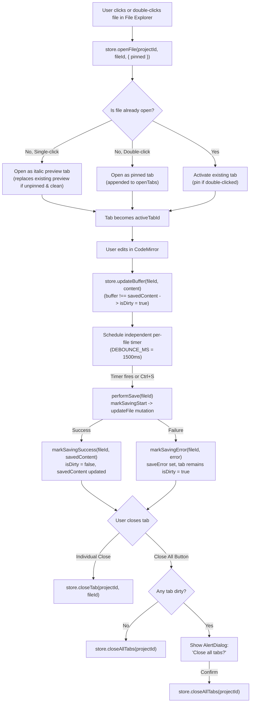

# Editor Tab and Dirty-State Lifecycle

This document provides a technical reference for editor tab management, dirty-state tracking, autosave semantics, external conflict resolution, and tab-closing behaviors in Nexus.

---

## 1. Overview

In Nexus, the code editor interface is built on **CodeMirror 6**, **Zustand** client-side tab state management, and reactive **Convex** backend synchronization:

- **Editor Tab:** Represents an open project file within the workspace editor pane. Each tab is uniquely identified by its Convex file ID (`Id<"files">`).
- **Tab State (`useEditorStore`):** Tracks open tab IDs, the currently active tab, preview/pinned state, and an in-memory buffer metadata map (`tabData: Map<Id<"files">, TabData>`).
- **Dirty State:** A tab is considered dirty (`isDirty === true`) when its in-memory buffer content differs from the persisted `savedContent` baseline.
- **Autosave (`EditorView`):** Automatically debounces buffer edits on a per-file timer (1,500 ms) and commits changes to Convex via `api.files.updateFile`.
- **Conflict Handling:** When an active file document is modified remotely (e.g. by the background AI coding agent), Nexus compares remote content against local edits and presents resolution actions if unsaved local changes exist.

---

## 2. Editor Tab Lifecycle



### Lifecycle Stages
1. **Opening a File:**
   - Single-clicking a file in the project explorer opens it as a **preview tab** (`pinned: false`). It is styled with italic text. Opening another file in preview mode replaces the previous unpinned preview tab (provided the previous tab was clean).
   - Double-clicking opens the file as a **pinned tab** (`pinned: true`), or pins an existing preview tab.
   - Opening an already-open file activates it without duplicating the tab in `openTabs`.
2. **Buffer Edits:**
   - Any keystroke in CodeMirror triggers `handleBufferChange`, which updates the file's in-memory `buffer` and evaluates `isDirty = (newContent !== current.savedContent)`.
3. **Autosave:**
   - Each file manages an independent timer (`autosaveTimersRef: Map<Id<"files">, NodeJS.Timeout>`).
   - Debounce period: **1,500 ms** (`DEBOUNCE_MS`).
   - Timer expiration calls `performSave(fileId)` to persist to Convex. Manual shortcut (`Ctrl+S` / `Cmd+S`) or clicking **Save** bypasses the timer and saves immediately.
4. **Clean State Restoration:**
   - Upon mutation success, `markSavingSuccess` updates `savedContent`, sets `isDirty = false` (if the buffer has not changed during the save operation), and clears any error indicators.
5. **Closing:**
   - Individual tabs close immediately via the tab's close icon (`x`) or `Ctrl+W`/`Cmd+W`.
   - The close-all button triggers confirmation if any open tab is dirty.

---

## 3. Dirty-State Semantics

### What Makes a Tab Dirty?
In `use-editor-store.ts`, a tab's dirty state is strictly governed by:
```ts
const isDirty = content !== current.savedContent;
```
- If the user modifies content, the tab immediately becomes dirty (`isDirty = true`).
- If the user undoes or restores content back to the exact initial `savedContent` baseline before autosave runs, `isDirty` reverts immediately to `false`.

### UI Indicators
- **Unsaved Changes (Dirty):** Amber dot (`bg-amber-500`) in the tab header and an `"Unsaved changes"` label in the editor status bar.
- **Saving:** Blue pulsing dot (`bg-blue-500 animate-pulse`) in the tab header and spinning icon with `"Saving..."` in the status bar.
- **Save Failed:** Red text and alert icon with `"Save failed: <error>"` in the status bar. The tab remains dirty.
- **Saved (Clean):** Green checkmark with `"Saved"` in the status bar. No dot in the tab header.
- **Conflict:** Red dot (`bg-red-500`) in the tab header and amber conflict banner above the editor.

### Tab Switching Independence
Each tab's buffer, saved baseline, dirty flag, and saving status are maintained in an isolated `TabData` record in Zustand (`tabData.get(fileId)`). Switching between active tabs does **not** reset, discard, or overwrite dirty buffers in background tabs.

### Browser Navigation Protection (`beforeunload`)
In `EditorView`:
```ts
const handleBeforeUnload = (e: BeforeUnloadEvent) => {
  if (hasDirtyTabs()) {
    e.preventDefault();
    e.returnValue = "";
  }
};
```
If any tab across the active project contains unsaved changes, navigating away from the page or closing the browser window prompts the browser's native confirmation dialog.

---

## 4. Autosave Lifecycle

### Debounce Mechanics
- **Timer Duration:** 1,500 ms (`DEBOUNCE_MS = 1500`).
- **Independent Timers:** Nexus maintains independent autosave timers per file ID (`Map<Id<"files">, NodeJS.Timeout>`). Typing in File A and immediately switching to File B to type there will not cancel or delay File A's pending autosave.
- **Manual Save Override:** Pressing `Ctrl+S` / `Cmd+S` or clicking the **Save** button clears the pending timer and runs `performSave` synchronously.

### Overlapping Save Protection (`markSavingStart`)
To prevent race conditions where a user continues typing while an asynchronous save mutation is in flight:
1. `markSavingStart(fileId)` sets `isSaving = true` and snapshots the current buffer content (`contentToSave`).
2. The network request (`updateFile({ id, content: contentToSave })`) is dispatched.
3. In `markSavingSuccess(fileId, savedContent)`:
   ```ts
   const stillMatches = current.buffer === savedContent;
   tabData.set(fileId, {
     ...current,
     savedContent,
     isDirty: !stillMatches,
     isSaving: false,
   });
   ```
   If the user typed additional characters while the mutation was in-flight, `current.buffer !== savedContent`. The tab remains `isDirty = true` and the subsequent debounce timer persists the newer content.

### Save Errors
If the Convex mutation fails (e.g., network drop, permissions error):
- `markSavingError(fileId, errorMsg)` sets `isSaving = false` and records `saveError`.
- `isDirty` remains `true` so changes are not lost.
- The editor status bar displays `"Save failed: <error>"`.

---

## 5. External Changes & Conflict Detection

Nexus applications can have their files edited externally by background AI workflows (e.g. Inngest agent executing `create_file` or `update_file` tools). Convex pushes these updates in real-time via reactive subscriptions.

### Detection Logic (`handleRemoteUpdate`)
When `activeFile` changes in Convex, `EditorView` invokes `handleRemoteUpdate(fileId, remoteContent, remoteUpdatedAt)`:

1. **Remote matches current saved content:**
   If `remoteContent === current.savedContent`, no external change occurred (it reflects the user's own save). Update `savedUpdatedAt` and ignore.
2. **Local tab is clean (`!current.isDirty`):**
   The user has no pending edits. Nexus automatically updates both the buffer and saved baseline to `remoteContent`. No conflict is surfaced.
3. **Local buffer identically matches remote content:**
   If the user's unsaved buffer happens to match the remote content, the tab transitions to clean (`isDirty = false`).
4. **Local tab is dirty and remote content differs from saved content:**
   The user has unpersisted local changes, and an external actor modified the file simultaneously. Nexus enters conflict mode:
   - Sets `hasConflict = true`.
   - Preserves the user's local buffer.
   - Stores `remoteContent` and `remoteUpdatedAt`.
   - Displays the conflict banner above the editor.

### Conflict Resolution Actions
When a conflict is active, the conflict banner provides two user actions:

| Resolution Option | Method | Behavior |
| :--- | :--- | :--- |
| **"Accept external changes"** | `resolveConflictAcceptRemote(fileId)` | Discards local buffer; overwrites buffer and `savedContent` with the external content; clears `hasConflict` and marks tab clean (`isDirty = false`). |
| **"Keep my changes & save"** | `resolveConflictKeepLocal(fileId)` followed by `performSave(fileId)` | Dismisses the conflict banner, retains the local buffer, and immediately forces an autosave mutation to overwrite the remote file with the local version. |

---

## 6. Closing Tabs and Confirmation Behavior

| User Action | Clean Tab Behavior | Dirty Tab Behavior | Confirmation Required? |
| :--- | :--- | :--- | :--- |
| **Click tab close button (`X`)** | Tab closes immediately; buffer discarded from store. | Tab closes immediately; unsaved changes in buffer are discarded. | **No** (closes immediately) |
| **Keyboard shortcut (`Ctrl+W` / `Cmd+W`)** | Active tab closes immediately. | Active tab closes immediately; unsaved changes discarded. | **No** (closes immediately) |
| **Close All Tabs button (`XCircleIcon`)** | All open tabs close immediately (`closeAllTabs`). | If any open tab is dirty (`hasDirtyTabs() === true`), opens confirmation dialog. | **Yes** (when any tab is dirty) |
| **Confirm "Close all tabs?" dialog** | N/A | All tabs close (`closeAllTabs()`), clearing `openTabs` and all tab buffers. | N/A |
| **Cancel "Close all tabs?" dialog** | N/A | Dialog dismisses; all tabs and dirty buffers remain intact. | N/A |
| **Delete single file in File Explorer** | Calls `closeTab(fileId)` and `deleteFile({ id })`. Tab closes immediately. | Calls `closeTab(fileId)` and `deleteFile({ id })`. Unsaved changes discarded with file deletion. | **No** (handled via file delete confirmation) |
| **Delete folder in File Explorer** | Deletes folder recursively. Closes all open tabs matching `result.deletedFileIds`. | Closes all open descendant tabs regardless of dirty state. | **No** (handled via folder delete confirmation) |

### Active Tab Adjustment on Close
When the active tab is closed (`closeTab`):
1. If no tabs remain, `activeTabId` becomes `null`.
2. If the closed tab was the rightmost tab, focus switches to the new rightmost tab (`newTabs[newTabs.length - 1]`).
3. Otherwise, focus shifts to the adjacent tab occupying the same index (`newTabs[tabIndex]`).

---

## 7. State Ownership and Code References

| Responsibility | Implementation File | Key Functions / Components |
| :--- | :--- | :--- |
| **Tab State Store** | [`src/features/editor/store/use-editor-store.ts`](../src/features/editor/store/use-editor-store.ts) | `useEditorStore`, `openFile`, `closeTab`, `closeAllTabs`, `updateBuffer`, `handleRemoteUpdate` |
| **Editor Facade Hook** | [`src/features/editor/hooks/use-editor.ts`](../src/features/editor/hooks/use-editor.ts) | `useEditor(projectId)` scoped hook exporting tab actions and state |
| **Tab Navigation Header** | [`src/features/editor/components/top-navigation.tsx`](../src/features/editor/components/top-navigation.tsx) | `TopNavigation`, `Tab`, close-all `AlertDialog`, `Ctrl+W` keyboard listener |
| **Editor View & Autosave** | [`src/features/editor/components/editor-view.tsx`](../src/features/editor/components/editor-view.tsx) | `EditorView`, `handleBufferChange`, `performSave`, `handleBeforeUnload`, conflict banner |
| **Code Editor Component** | [`src/features/editor/components/code-editor.tsx`](../src/features/editor/components/code-editor.tsx) | CodeMirror 6 view initialization, change listener, cursor position reporting |
| **Explorer Tab Coordination** | [`src/features/projects/components/file-explorer/tree.tsx`](../src/features/projects/components/file-explorer/tree.tsx) | File opening (`openFile`), single-file delete tab cleanup, recursive folder delete cleanup |

### Focused Test Suites
- **Store & Conflict Detection Unit Tests:** [`tests/editor-dirty-tabs-conflict.test.js`](../tests/editor-dirty-tabs-conflict.test.js)  
  *Covers dirty tracking, tab switching buffer preservation, conflict detection, resolution actions, and recursive folder deletion cleanup.*
- **Autosave Timers & Save Controls:** [`tests/unit/editor-autosave.test.tsx`](../tests/unit/editor-autosave.test.tsx)  
  *Covers independent autosave timers per tab, 1,500ms debounce, manual save button, and dirty status indicators.*
- **Tab Accessibility & Reordering:** [`tests/unit/top-navigation-accessibility.test.tsx`](../tests/unit/top-navigation-accessibility.test.tsx)  
  *Covers close button accessibility, close-all dialog confirmation, keyboard shortcuts, and tab drag-and-drop.*

---

## 8. Troubleshooting and Contributor Guidance

| Symptom | Likely Cause | What to Inspect |
| :--- | :--- | :--- |
| **Tab remains dirty after typing has stopped** | Autosave timer failed to trigger or Convex mutation rejected. | Check browser console and status bar for `"Save failed: <error>"`. Inspect `performSave` in `editor-view.tsx` and verify `useUpdateFile` connectivity. |
| **Tab incorrectly marked dirty immediately on open** | Initial file content mismatch between Convex document and store initialization. | Verify `initFileContent` in `use-editor-store.ts`. Ensure initial content passed from `useFile` matches `activeFile.content`. |
| **Conflict banner appears unexpectedly** | Background agent or external process modified the file while local edits were pending. | Inspect `handleRemoteUpdate` in `use-editor-store.ts`. Verify if `remoteContent !== current.savedContent`. |
| **Closing all tabs does not prompt for confirmation** | Store reports `hasDirtyTabs() === false` because buffers matched `savedContent`. | Verify `isFileDirty` and `hasDirtyTabs` in `use-editor-store.ts`. Check whether pending edits were already autosaved. |
| **Deleted file tab remains visible in top navigation** | Tab close was not triggered during file or folder deletion. | Check `onDelete` handler in `tree.tsx`. For folders, verify that `deleteFile` returns `deletedFileIds` and that `closeTab(fileId)` is called for each ID. |
