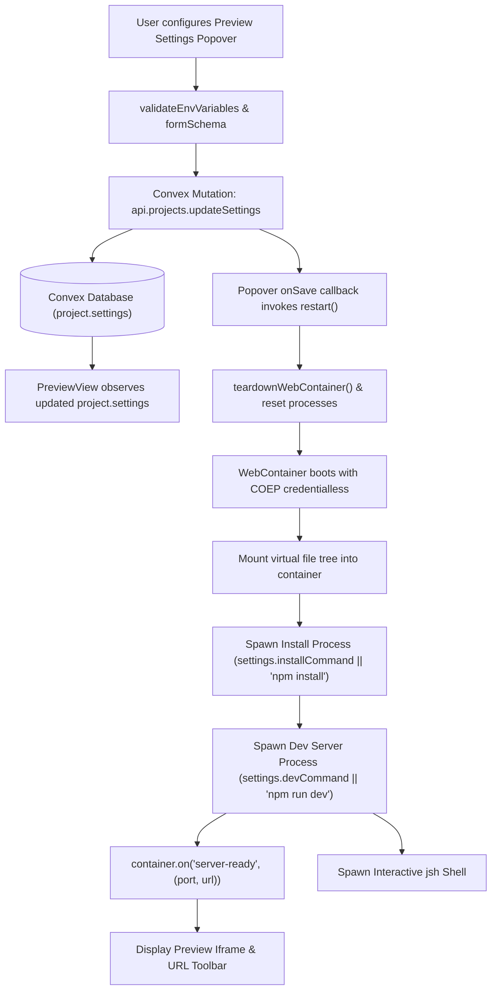

# WebContainer Preview Command and Environment Semantics

This document provides a technical reference for WebContainer preview settings in Nexus. It details default commands, command parsing and execution rules, environment variable validation and injection, the settings save/restart lifecycle, preview URL detection, and diagnostic troubleshooting.

---

## 1. Overview

Nexus runs user projects directly inside the browser using Node.js WebAssembly containers via the **WebContainer API** (`@webcontainer/api`). 

### Settings-to-Execution Lifecycle



1. **Configuration:** The user adjusts the install command, dev/start command, and environment variables in the preview settings popover (`src/features/preview/components/preview-settings-popover.tsx`).
2. **Validation & Normalization:** Commands are trimmed; empty commands are stored as `undefined`. Environment variable strings are validated line-by-line.
3. **Persistence:** The settings payload is saved to Convex via `api.projects.updateSettings`.
4. **Restart & Execution:** On successful save, `onSave?.()` triggers `restart()`, which tears down existing container processes and executes a fresh boot, mount, installation, dev server startup, and interactive shell session with the configured settings.
5. **Server-Ready Detection:** WebContainer fires a `server-ready` event when the development server begins listening on an internal HTTP port, updating the UI with the preview URL.

---

## 2. Default Commands & Command Parsing

### Default Commands

| Setting Field | Popover UI Placeholder | Fallback at Execution (`useWebContainer`) | Stored in Convex if Unchanged / Blank |
| :--- | :--- | :--- | :--- |
| `installCommand` | `npm install` | `npm install` | `undefined` (omitted) |
| `devCommand` | `npm run dev` | `npm run dev` | `undefined` (omitted) |

- **Empty / Omitted Values:** When a user leaves an input blank or enters whitespace only, the popover normalizes it with `.trim() || undefined`. The database stores `undefined` rather than an empty string.
- **Runtime Fallback:** In `use-webcontainer.ts`, runtime fallbacks evaluate as:
  ```ts
  const installCmd = settings?.installCommand?.trim() || "npm install";
  const devCmd = settings?.devCommand?.trim() || "npm run dev";
  ```
  If `settings` or the individual command field is absent or empty, the execution layer defaults to `npm install` and `npm run dev`.

### Command Parsing Rules (`parseCommand`)

WebContainer executes binaries directly via `container.spawn(executable, args, options)`. Rather than invoking an underlying shell (`/bin/sh` or `cmd.exe`), Nexus parses command strings using a custom state-machine tokenizer in `src/features/preview/utils/command-parser.ts`:

- **Tokenization:** Splits on unquoted whitespace (`\s`).
- **Quotes:** Supports double quotes (`"..."`) and single quotes (`'...'`), allowing arguments with spaces (e.g. `pnpm --filter "web app" dev`).
- **Escapes:** Supports backslash escaping (`\ ` outside quotes; `\"` or `\\` inside double quotes).
- **Empty Quoted Arguments:** Tokens like `""` or `''` produce empty string arguments.
- **Errors (`CommandParseError`):**
  - Empty or whitespace-only commands: `"Command cannot be empty"`.
  - Unclosed single or double quotes: `"Unclosed single quote in command"`, `"Unclosed double quote in command"`.
  - Trailing backslashes: `"Trailing backslash at end of command"`.
  - Commands without an executable: `"Command contains no executable"`.

> [!IMPORTANT]
> **Shell Features Not Supported:** The command parser deliberately does **not** support shell redirection (`>`, `|`), chaining operators (`&&`, `||`, `;`), environment-variable expansion (`$PORT`, `$VAR`), or globbing (`*.js`). All characters are passed literally as arguments to the binary.

---

## 3. Environment Variable Parsing & Validation

Environment variables are entered in the settings popover as multiline plain text. Validation and parsing are handled by `validateEnvVariables` in `src/features/preview/components/preview-settings-popover.tsx`.

### Parsing Rules

- **Line Splitting:** The raw text is split by newline (`\n`).
- **Whitespace Handling:** Each line is trimmed of leading and trailing whitespace.
- **Blank Lines:** Empty or whitespace-only lines are ignored (`continue`).
- **Comments:** Lines starting with `#` are ignored as comments (`trimmed.startsWith("#")`). Note: inline comments following a value are **not** stripped; characters following `=` are treated as part of the value.
- **Key-Value Separator:** The line is split at the **first** `=` character (`indexOf("=")`).
- **Values with `=`:* Any subsequent `=` characters remain part of the value string. For example, `API_KEY=abc=123` assigns `"abc=123"` to `API_KEY`.
- **Value Whitespace & Empty Values:** Values are trimmed. Values can be empty string (e.g., `OPTIONAL_FLAG=` results in `""`).
- **Key Validation:** Keys must match the identifier regex:
  ```ts
  export const ENV_VAR_NAME_REGEX = /^[A-Za-z_][A-Za-z0-9_]*$/;
  ```
  Variable names must start with a letter (`A-Z`, `a-z`) or underscore (`_`), followed only by alphanumeric characters and underscores. Names with hyphens (e.g. `MY-KEY`) or special characters are rejected.
- **Duplicate Keys:** If a key appears multiple times in valid syntax, subsequent lines overwrite earlier values (`env[key] = val`).
- **Error Formatting:** If any line lacks an `=` separator or has an invalid key, `validateEnvVariables` returns structured errors:
  - Missing separator: `Line X: Missing "=" separator.`
  - Invalid name: `Line X: Invalid environment variable name "KEY".`
  The form displays these errors beneath the input, and submission is prevented.

### Injection into WebContainer

Parsed environment variables form a `Record<string, string>`. When launching processes in `use-webcontainer.ts`, this record is passed directly to `container.spawn`:

1. **Installation Process:**
   ```ts
   container.spawn(installBin, installArgs, {
     env: settings?.envVariables,
     terminal: terminalDimensionsRef.current,
   });
   ```
2. **Development Server Process:**
   ```ts
   container.spawn(devBin, devArgs, {
     env: settings?.envVariables,
     terminal: terminalDimensionsRef.current,
   });
   ```
3. **Interactive Shell (`jsh`):**
   ```ts
   container.spawn("jsh", {
     env: settings?.envVariables,
     terminal: terminalDimensionsRef.current,
   });
   ```

All three processes receive the exact same environment dictionary.

---

## 4. Settings Save and Restart Lifecycle

Understanding the distinction between saving settings and restarting execution is critical for predictable preview behavior:

### Persistence in Convex
When the user clicks **Save** in the settings popover:
1. `validateEnvVariables` verifies all lines.
2. `useUpdateProjectSettings` dispatches `api.projects.updateSettings`:
   ```ts
   await updateSettings({
     id: projectId,
     settings: {
       installCommand: value.installCommand.trim() || undefined,
       devCommand: value.devCommand.trim() || undefined,
       envVariables: Object.keys(result.env).length > 0 ? { ...result.env } : undefined,
     },
   });
   ```
3. Convex validates authentication (verifying `project.ownerId === identity.subject`) and patches the `settings` object on the `projects` document.

### Restart Execution (`onSave={restart}`)
- **Automatic Popover Restart:** In `src/features/projects/components/preview-view.tsx`, the popover is mounted with:
  ```tsx
  <PreviewSettingsPopover
    projectId={projectId}
    initialValues={project?.settings}
    onSave={restart}
  />
  ```
- **What `restart()` Does:**
  1. Releases lock and closes the input writer for `shellProcess`.
  2. Calls `.kill()` on `shellProcessRef`, `devProcessRef`, and `installProcessRef`.
  3. Calls `teardownWebContainer()`, destroying the active WebContainer singleton instance.
  4. Resets runtime references (`hasStartedRef = false`, snapshots cleared, status set to `"idle"`, `previewUrl` cleared).
  5. Increments `restartKey`, which triggers the primary `useEffect` in `use-webcontainer.ts` to re-boot WebContainer from scratch.
- **Reinstallation:** Because `restart()` tears down the container and triggers a complete re-boot, changing the install command or environment variables **always re-runs the install command** and boots fresh processes.
- **Live File Sync vs. Settings:** While ordinary project file changes trigger real-time incremental diffing (`computeFileTreeDiff`) without rebooting the container, **saving settings triggers a full container restart**.

---

## 5. Preview URL Detection

WebContainer provides automated virtual port forwarding and HTTP routing inside the browser.

### The `server-ready` Event
During container startup in `use-webcontainer.ts`:
```ts
const unsubscribeServerReady = container.on("server-ready", (_port, url) => {
  if (!isMounted) return;
  setPreviewUrl(url);
  setStatus("running");
});
```

- **Callback Arguments:** The callback provides `port` (number, e.g. `3000` or `5173`) and `url` (e.g. `https://localhost-3000.local-credentialless.webcontainer.io` or an internal blob URL depending on browser runtime).
- **Single Active URL:** The application currently tracks a single `previewUrl` state variable. If the development process listens on multiple ports sequentially, the most recent `server-ready` invocation updates `previewUrl`.
- **UI Reflection:** Once `previewUrl` is set:
  - The status row transitions from `"installing"` to `"running"`.
  - The preview iframe (`<iframe>`) renders the URL.
  - The URL address bar displays the current URL with **Copy URL** and **Open in New Tab** buttons.

### Server-Ready Failure Modes
If the development command terminates early (exit code non-zero), hangs indefinitely before binding to a port, or binds exclusively to `127.0.0.1` in frameworks that require `--host` (e.g. Vite without `--host`), the `server-ready` event will not fire. The preview displays an interactive terminal showing the server's stdout/stderr so contributors can diagnose port binding issues.

---

## 6. Troubleshooting WebContainer Settings

| Symptom | Likely Cause | Recommended Action |
| :--- | :--- | :--- |
| **Dependencies fail to install** | The custom install command failed with a non-zero exit code or could not be parsed. | 1. Open the preview terminal to inspect the installation output.<br>2. Verify package manager availability (npm and pnpm are supported in WebContainer).<br>3. Check for syntax errors in package.json. |
| **`Invalid install command configuration: Command contains no executable`** | Install command was set to quotation marks with no command or invalid syntax. | Re-open Preview Settings and enter a valid command like `npm install` or leave blank for default. |
| **Dev server exits immediately with code 1** | Missing dependencies, syntax error in project files, or invalid script name in package.json. | Inspect the terminal logs in the preview panel. Ensure `package.json` contains the script named in your start command (e.g., `"dev": "vite"` for `npm run dev`). |
| **Preview URL is never detected ("installing" or blank screen)** | Dev server started but bound to localhost only without external host exposure, or failed to start an HTTP listener. | For Vite or similar bundlers, configure the start command with `--host` (e.g. `npm run dev -- --host`) to allow WebContainer's virtual network interface to detect the listening port. |
| **Environment variable missing in process** | Line was formatted without `=`, had an invalid key name, or started with `#`. | Ensure each variable follows `KEY=VALUE` on its own line. Keys must use letters, numbers, and underscores only (`/^[A-Za-z_][A-Za-z0-9_]*$/`). |
| **Settings change did not take effect** | Network issue saving to Convex or modal was dismissed without clicking Save. | Click **Save** in the popover. Check for validation errors in red beneath the fields. Verify successful save via network tab (`api.projects.updateSettings`). |

---

## 7. Related Documentation

- [Local Service Topology Guide](local-service-topology.md) — Comprehensive guide on local Next.js, Convex, and Inngest execution.
- [WebContainer Browser Compatibility & Deployment Guide](architecture.md#9-webcontainer-browser-compatibility-and-deployment-guide) — Cross-origin isolation (`COEP: credentialless`, `COOP: same-origin`) and browser support.
- [Convex Data Model and Mutation Lifecycle](architecture.md#8-convex-data-model-and-mutation-lifecycle) — Project schema definition including `settings` object.
